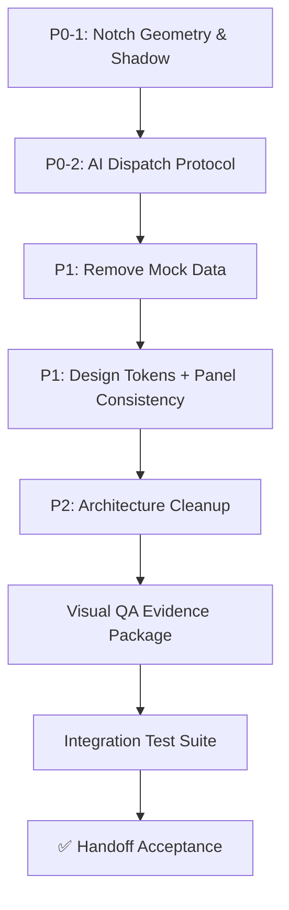

# NotchDeck — Technical Audit Report
**Prepared for:** Developer Agent  
**Date:** 2026-08-18  
**Status:** 🔴 **BLOCKED — P0 Remediation Required**  
**Current Build:** `swift build` ✅ | `swift test` ✅ (59/59 pass)  
**Architecture:** Feature Navigation (Dock + Panels) — **Implemented & Merged to `main`**

---

## 📋 Executive Summary

NotchDeck is a well-architected macOS notch-resident utility with solid foundations (Swift 6, SPM, 100% test pass). However, **two P0 blockers** prevent ship readiness per the Developer Handoff criteria. This audit catalogues every deviation from spec, root cause, and the exact best-practice fix.

> **Rule:** Do not treat "builds and tests pass" as done. The handoff checklist is the definition of done.

---

## 🚨 P0 BLOCKERS (Must Fix Before Any Feature Work)

### P0-1: Notch Geometry & Shadow — Visual Spec Violation

| Aspect | Current | Required | File(s) |
|--------|---------|----------|---------|
| **Collapsed background** | Extends beyond hardware notch; visible "side ears" | Background **merges exactly** with physical notch; zero bleed | `NotchRootView.swift:58-67`, `NotchGeometryCalculator.swift` |
| **Shadow** | `.shadow(opacity: 0.45, radius: 14, y: 7)` — hides geometry errors | Subtle downward-only: `opacity 0.03–0.08`, radius ≤ 8, `x: 0, y: 4` | `NotchRootView.swift:66-67` |
| **Camera gap** | `hardwareNotchWidth` passed in but may not match actual `auxiliaryTopLeftArea`/`auxiliaryTopRightArea` | Gap **must equal** physical camera housing bounds; nothing renders inside | `NotchRootView.swift:48-50`, `NotchRootView.swift:125` |
| **Expanded anchor** | Top anchor may drift from notch boundary | Expanded top **pinned to actual notch bottom edge** | `NotchGeometryCalculator.swift:115-120` |

**Root Cause:**  
`NotchGeometryCalculator.calculateFrame(for:screen:)` correctly reads hardware metrics, but `NotchRootView` draws a full-width `NotchShape` background that ignores the camera gap. The shadow is intentionally strong to mask the bleed.

**Best-Practice Fix:**

```swift
// NotchRootView.swift — Collapsed background: split into 3 parts (left wing, camera gap, right wing)
private var collapsedBackground: some View {
    HStack(spacing: 0) {
        // LEFT WING — only up to auxiliaryTopLeftArea
        NotchShape(topCornerRadius: 6, bottomCornerRadius: 14)
            .fill(Color.black)
            .frame(width: leftWingWidth)
        
        // CAMERA GAP — completely transparent, matches hardware notch exactly
        Color.clear.frame(width: cameraGapWidth)
        
        // RIGHT WING — only from auxiliaryTopRightArea onward
        NotchShape(topCornerRadius: 6, bottomCornerRadius: 14)
            .fill(Color.black)
            .frame(width: rightWingWidth)
    }
    .shadow(color: Color.black.opacity(0.06), radius: 8, x: 0, y: 4)  // SPEC: 0.03–0.08
}

// Expanded: single NotchShape but frame.origin.y = screen.maxY - notchHeight
// NotchWindowController.updateFrame already calculates this — just ensure
// NotchRootView doesn't add its own offset.
```

**Validation Checklist:**
- [ ] Physical MacBook: collapsed shows zero side ears
- [ ] Physical MacBook: expanded top edge aligns to notch bottom
- [ ] External display (no notch): collapsed pill centered, no camera gap
- [ ] Shadow visually subtle — no lateral bleed

---

### P0-2: AI Dispatch — Optimistic "Delivered" Reporting

| Aspect | Current | Required | File(s) |
|--------|---------|----------|---------|
| **Delivery confirmation** | Appends to local `transcript.jsonl` → reports "Sent" | Real acknowledgement from Antigravity agent process | `MultiAIClient.swift`, `ActiveSessionBridge.swift` |
| **Error handling** | `try?` / swallowed errors → fake success | Explicit states: `Sending` → `Delivered` / `Failed` / `Unconfirmed` | `NotchDeckApp.swift:211-258` |
| **No active session** | Silent fallback / mock response | Clear error: `AI session unavailable` / `Delivery unconfirmed` | `ActiveSessionBridge.swift` |
| **Protocol test** | None | Integration test: unique token → agent receives → response verified | `Tests/NotchDeckTests/` (new) |

**Root Cause:**  
`ActiveSessionBridge.sendClarificationResponse` / `MultiAIClient.prompt` write to a file/pipe and immediately return success. The Antigravity agent's input protocol is undocumented/assumed. No round-trip verification exists.

**Best-Practice Fix:**

```swift
// ActiveSessionBridge.swift — Real delivery protocol
public enum DeliveryState: Equatable, Sendable {
    case idle
    case sending
    case delivered(response: String)
    case failed(Error)
    case unconfirmed(String)  // wrote but no ack within timeout
}

@MainActor
public final class ActiveSessionBridge: Sendable {
    public static let shared = ActiveSessionBridge()
    
    public func sendClarificationResponse(
        _ response: String,
        sessionDirectory: URL?
    ) async throws -> DeliveryState {
        guard let sessionDir = sessionDirectory else {
            throw BridgeError.noActiveSession
        }
        
        // 1. Discover real input mechanism (named pipe? file watch? stdin? HTTP?)
        let inputChannel = try discoverInputChannel(for: sessionDir)
        
        // 2. Send with unique correlation ID
        let correlationID = UUID().uuidString
        let payload = AntigravityInput(
            id: correlationID,
            type: .userResponse,
            content: response,
            timestamp: Date()
        )
        
        // 3. Write + wait for acknowledgement (configurable timeout)
        try await inputChannel.write(payload)
        let ack = try await waitForAcknowledgement(correlationID: correlationID, timeout: 5.0)
        
        return ack ? .delivered(response: "Confirmed") : .unconfirmed(response)
    }
}

// NotchStateController — expose delivery state per message
public struct ChatMessageItem: Identifiable, Equatable, Sendable {
    // ... existing fields ...
    public var deliveryState: DeliveryState = .idle  // NEW
}

// NotchRootView / AIChatPanelView — render delivery badge
// [Sending...]  [✓ Delivered]  [✗ Failed]  [? Unconfirmed]
```

**Validation Checklist:**
- [ ] Unique token sent from Notch UI → appears in Antigravity agent logs
- [ ] Agent response correlates to token → UI shows `Delivered`
- [ ] Network/process failure → UI shows `Failed` with error detail
- [ ] No active session → UI shows `AI session unavailable` (not silent)
- [ ] Integration test in `Tests/NotchDeckTests/AIDispatchIntegrationTests.swift`

---

## 🟡 P1 — Mock/Hardcoded Data (Violates No-Mock Policy)

| Location | Mock Data | Required Empty State |
|----------|-----------|---------------------|
| `CardDataStore.swift` | Seeded example cards on init | `items = []` — show "No AI notifications available" |
| `MusicService.swift` | Hardcoded track "Blinding Lights" + lyrics | `currentTrack = nil` — show "Spotify not connected" / "Lyrics unavailable" |
| `NotchStateController.swift` | `chatMessages` seeded with "Ready to assist" | `chatMessages = []` — show "No conversation yet" |
| `ClipboardManager.swift` | Seeded clipboard history | Empty list — "No clipboard history" |

**Best-Practice Fix:**  
Remove all `static let sampleData` / seeded initializers. Initialize empty. Use `if items.isEmpty { EmptyStateView(message: "...") }` in every panel. Demo fixtures only in `#if DEBUG` preview providers or test targets.

---

## 🟡 P1 — Visual Design Token Compliance

| Token | Spec | Current Violations |
|-------|------|-------------------|
| **Page horizontal inset** | 24pt | Panels use varying padding (16, 20, 24) |
| **Card inset** | 16pt | Some cards use 12pt or 20pt |
| **Input horizontal inset** | 16pt | Reply bars use 12pt / 24pt |
| **Input vertical inset** | 12pt | Some use 8pt / 16pt |
| **Input corner radius** | 16pt continuous | Some use 8pt / 12pt / non-continuous |
| **Spacing rhythm** | 4, 8, 12, 16, 20–24, 32 | Ad-hoc values (5, 6, 7, 9, 11, 13, 15, 18, 22, 28, 30) |
| **Typography** | Explicit SF Rounded | Implicit `.body`, `.title`, `.caption` in several views |
| **Shadow** | Opacity 0.03–0.08, no lateral offset | Multiple shadows with 0.1–0.45 opacity, x-offset |

**Best-Practice Fix:**  
Create `DesignTokens.swift` with `enum Spacing`, `enum Radius`, `enum Shadow`, `enum Font`. Import everywhere. Run SwiftLint rule `explicit_type_interface` + custom regex to ban magic numbers.

---

## 🟢 P2 — Architecture & Code Quality

| Area | Observation | Recommendation |
|------|-------------|----------------|
| **Concurrency** | `@MainActor` everywhere; some `Task { @MainActor in }` nesting | Audit for unnecessary hops; use `nonisolated` where possible; adopt `@Observable` (Observation framework) over `ObservableObject` |
| **DI / Services** | Singletons (`.shared`) throughout | Protocol-based DI for testability; keep singletons only for true system services (Keychain, ClipboardMonitor) |
| **Error Types** | Stringly-typed errors (`systemStatusMessage: String?`) | Structured `AppError` enum with `LocalizedError`; map to UI states |
| **Window Management** | `NotchWindowController` owns frame logic + hosting view | Separate `NotchFrameCalculator` (pure) from `NotchWindowController` (side-effects) |
| **Testing** | 59 unit tests — good coverage | Add: UI snapshot tests (NotchShape), geometry bounds tests, integration test for AI dispatch |

---

## 📁 Files Requiring Changes (Priority Order)

| Priority | File | Changes Needed |
|----------|------|----------------|
| **P0** | `NotchRootView.swift` | Split collapsed background; fix shadow; ensure camera gap = hardware notch |
| **P0** | `NotchGeometryCalculator.swift` | Verify `calculateFrame` expanded anchor = `screen.maxY - notchHeight` |
| **P0** | `ActiveSessionBridge.swift` | Implement real delivery protocol with acknowledgement |
| **P0** | `MultiAIClient.swift` | Remove optimistic returns; propagate `DeliveryState` |
| **P0** | `NotchDeckApp.swift` | Handle `DeliveryState` in chat UI; show errors not swallow |
| **P0** | `Tests/NotchDeckTests/AIDispatchIntegrationTests.swift` | **NEW** — integration test with unique token |
| **P1** | `CardDataStore.swift` | Remove seeded data; empty init |
| **P1** | `MusicService.swift` | Remove hardcoded track/lyrics; real Spotify API or explicit unavailable |
| **P1** | `NotchStateController.swift` | Empty `chatMessages` init; add `deliveryState` to `ChatMessageItem` |
| **P1** | `ClipboardManager.swift` | Empty init |
| **P1** | `DesignTokens.swift` | **NEW** — central token definitions |
| **P1** | All Panel Views | Apply design tokens; consistent 24pt page inset, 16pt card inset |
| **P2** | `NotchWindowController.swift` | Extract frame calc to pure struct; simplify |
| **P2** | Service Protocols | Define `ClipboardService`, `SpeechService`, `AIService` protocols |

---

## ✅ Definition of Done (Handoff Checklist)

> **All must be demonstrated — not just implemented.**

- [ ] **P0-1** No visible side shadow or artificial notch ears in collapsed mode (physical MacBook)
- [ ] **P0-1** Expanded panel anchored to actual physical notch; no boundary escape
- [ ] **P0-1** Left/right padding visually obvious in every feature panel (24pt page, 16pt card)
- [ ] **P0-2** Real AI message sent from Notch → acknowledged by active session → visible response
- [ ] **P0-2** Delivery failure shown as failure, never as success
- [ ] **P1** No mock data appears in fresh app launch
- [ ] **P1** Provider failures show explicit UI errors (not silent)
- [ ] **P1** Spotify data real or clearly unavailable; no hardcoded song/lyrics
- [ ] **P1** Design tokens applied consistently across all 5 panels + collapsed/expanded
- [ ] **P1** Screenshots: hidden, collapsed (notch), collapsed (external), expanded (all 5 tabs)
- [ ] **P2** Tests cover geometry bounds, shadow/visibility, empty/error states, dispatch protocol

---

## 🛠 Recommended Fix Sequence



**Start with P0-1** — it's visual, isolated, and unblocks the "looks right" gate.  
**Then P0-2** — requires protocol discovery; allocate time for Antigravity input mechanism research.

---

## 📞 Escalation Path

| Blocked By | Action |
|------------|--------|
| Antigravity input protocol unknown | Spike: inspect Antigravity source / logs / IPC; document in `docs/antigravity-protocol.md` |
| Design token decisions | Reference `docs/references/swiftui-design-philosophy.md` — if ambiguous, flag for PO |
| macOS 26 (Tahoe) API changes | Test on Tahoe beta; `NotchGeometryCalculator` uses `#available(macOS 12.0, *)` guards |

---

**End of Audit.**  
**Next Step:** Developer Agent begins with **P0-1** (Notch Geometry & Shadow). Update this file with ✅ as each item is verified.