# ARCHITECTURE.md — Izanotchy End-to-End System Architecture Map

Single Source of Truth untuk pemetaan visual arsitektur end-to-end Izanotchy dari input prompt hingga output prompt. Berkas ini berfungsi sebagai peta referensi diagnosa ketika terjadi kegagalan sistem, sehingga setiap laporan bug atau Root Cause dapat merujuk langsung ke ID fase atau ID kotak spesifik.

---

## 1. Peta Diagram Alur End-to-End

```mermaid
flowchart TD
    subgraph S1["Fase S1: Ingress & Kontrak Kanonikal"]
        S1_01["[S1.01] User Prompt (Teks / Audio)"] --> S1_02["[S1.02] HomeSpaceRootView (UI Ingestion & PTT)"]
        S1_02 --> S1_03["[S1.03] AFMLunaCoordinationBridge (Ingress Dispatcher)"]
        S1_03 --> S1_04["[S1.04] TaskIngressGateway"]
        S1_04 --> S1_05["[S1.05] NLLanguageRecognizer (Deteksi Bahasa)"]
        S1_04 --> S1_06["[S1.06] AFM System 2 Ingress Parser"]
        S1_05 & S1_06 --> S1_07["[S1.07] Swift Ingress Harness (Guard & Schema)"]
        S1_07 --> S1_08["[S1.08] CanonicalTaskContract (JSON Kanonikal)"]
    end

    subgraph S2["Fase S2: Isolasi Workspace & Display"]
        S1_08 --> S2_01["[S2.01] MascotVirtualDesktopService"]
        S2_01 --> S2_02["[S2.02] CGVirtualDisplay (Isolated Workspace)"]
        S2_02 --> S2_03["[S2.03] CompanionWindowStreamService (Retina Stream)"]
    end

    subgraph S3["Fase S3: Persepsi Layar & Observasi UI"]
        S2_03 --> S3_01["[S3.01] CompanionVMAgentLoop (State Machine)"]
        S3_01 --> S3_02["[S3.02] ClickyUIObservationService"]
        S3_02 --> S3_03["[S3.03] AXUIElement Sensor (Hierarki Native)"]
        S3_02 --> S3_04["[S3.04] Vision OCR & Font-Height Gap Clustering"]
        S3_03 & S3_04 --> S3_05["[S3.05] Multi-Card Consensus Anchoring"]
        S3_05 --> S3_06["[S3.06] Targeted Section Observation Slicing"]
    end

    subgraph S4["Fase S4: Two-Tier Decision Engine"]
        S3_06 --> S4_01["[S4.01] LayaDecisionEngine (System 1 Router ~20ms)"]
        S4_01 --> S4_02{"[S4.02] Affordance & Confidence Gate"}
        S4_02 -- High Confidence Discrete Action --> S4_05["[S4.05] Discrete Atomic Action Decision"]
        S4_02 -- Ambigu / Low Confidence --> S4_03["[S4.03] TaskStepPlanner (System 2 AFM 3B)"]
        S4_03 --> S4_04["[S4.04] SiriAIEngine (AFM Daemon Port 1976)"]
        S4_03 & S4_04 --> S4_05
    end

    subgraph S5["Fase S5: Hybrid Grounding & Eksekusi Fisik"]
        S4_05 --> S5_01["[S5.01] ClickyHybridGroundingEngine"]
        S5_01 --> S5_02["[S5.02] AX Semantic Attribute Resolver"]
        S5_02 -- Element Missing / Miss --> S5_03["[S5.03] Luna Vision Grounder (Codex CLI gpt-6-luna)"]
        S5_01 --> S5_04["[S5.04] Form Field Adaptive Offset Resolver"]
        S5_02 & S5_03 & S5_04 --> S5_05["[S5.05] CUAPhysicalActionDispatcher"]
        S5_05 --> S5_06["[S5.06] Modular Hands (Click, Scroll, Type)"]
        S5_06 --> S5_07["[S5.07] InteractiveVirtualDesktopView (Kinetic Glide 45 FPS)"]
        S5_07 --> S5_08["[S5.08] Virtual Display Event Injection (PID IPC)"]
        S5_08 --> S2_02
    end

    subgraph S6["Fase S6: Validasi Egress & Output Synthesis"]
        S5_08 --> S6_01["[S6.01] TaskEgressValidator.evaluateTaskState"]
        S6_01 -- Butuh Izin Sensitif / Auth --> S6_02["[S6.02] Human Takeover Protocol ([✋ Take Over])"]
        S6_01 -- Tugas Belum Selesai (isDone: false) --> S6_03["[S6.03] Loop Recurrence Gate"]
        S6_03 --> S3_01
        S6_01 -- Target Tercapai (isDone: true) --> S6_04["[S6.04] Anti-Hallucination Egress Guard"]
        S6_04 --> S6_05["[S6.05] TaskEgressValidator.synthesizeUserResponse"]
        S6_05 --> S6_06["[S6.06] HomeSpace Chat Card Presentation & TTS"]
    end
```

---

## 2. Tabel Rujukan Diagnosa Kotak Komponen

Gunakan ID kotak di bawah ini saat menyusun Root Cause kegagalan sistem:

| ID Kotak | Nama Komponen | Berkas Kode Sumber | Tanggung Jawab Utama | Gejala Kerusakan jika Kotak Ini Gagal |
|---|---|---|---|---|
| **S1.01** | User Input Gateway | [HomeSpaceChatTranscriptView.swift](file:///Users/heizaaa/Desktop/cdev/iza-3/izaNotch/Clicky/UI/HomeSpace/HomeSpaceChatTranscriptView.swift) | Menerima teks atau audio pengguna. | Input tidak terkirim atau event push-to-talk tidak tertangkap. |
| **S1.02** | UI Ingestion View | [HomeSpaceRootView.swift](file:///Users/heizaaa/Desktop/cdev/iza-3/izaNotch/Clicky/UI/HomeSpace/HomeSpaceRootView.swift) | Mengikat state chat dan tombol kirim (`submitPrompt`). | Teks input macet atau antarmuka chat tidak responsif. |
| **S1.03** | Dispatcher Ingress | [AFMLunaCoordinationBridge.swift](file:///Users/heizaaa/Desktop/cdev/iza-3/izaNotch/Clicky/Reasoning/Coordination/AFMLunaCoordinationBridge.swift) | Mengoordinasikan parsing dekonstruksi tugas ke Ingress Gateway. | Task plan tidak terpicu setelah prompt dikirim. |
| **S1.04** | Ingress Gateway | [TaskIngressGateway.swift](file:///Users/heizaaa/Desktop/cdev/iza-3/izaNotch/Clicky/Reasoning/Ingress/TaskIngressGateway.swift) | Mengurai prompt menjadi kontrak tugas kanonikal. | Niat tugas salah diklasifikasikan (misal inspect terbaca compose). |
| **S1.05** | Deteksi Bahasa | [TaskIngressGateway.swift](file:///Users/heizaaa/Desktop/cdev/iza-3/izaNotch/Clicky/Reasoning/Ingress/TaskIngressGateway.swift) | Menentukan bahasa pengguna via Apple `NaturalLanguage`. | Respon akhir keluar dalam bahasa yang salah (misal English saat user pakai ID). |
| **S1.06** | System 2 Ingress Parser | [TaskIngressGateway.swift](file:///Users/heizaaa/Desktop/cdev/iza-3/izaNotch/Clicky/Reasoning/Ingress/TaskIngressGateway.swift) | Mengisi slot parameter kontrak tugas via AFM 3B. | Parameter entity target kosong atau salah terisi. |
| **S1.07** | Swift Ingress Harness | [TaskIngressGateway.swift](file:///Users/heizaaa/Desktop/cdev/iza-3/izaNotch/Clicky/Reasoning/Ingress/TaskIngressGateway.swift) | Penegakan skema kanonikal secara deterministik. | Null zeroing gagal atau ordinal target tidak dinormalisasi. |
| **S1.08** | Canonical Task Contract | [CanonicalTaskContract.swift](file:///Users/heizaaa/Desktop/cdev/iza-3/izaNotch/Clicky/Reasoning/Ingress/CanonicalTaskContract.swift) | Objek data kontrak tunggal antar-model (`AFMTaskDecomposition`). | Data kontrak tidak serializable atau properti tidak valid. |
| **S2.01** | Virtual Desktop Service | [MascotVirtualDesktopService.swift](file:///Users/heizaaa/Desktop/cdev/iza-3/izaNotch/Clicky/Workspace/VirtualDisplay/MascotVirtualDesktopService.swift) | Mengelola penempatan aplikasi di virtual display. | Jendela aplikasi muncul di layar host pengguna (bocor isolasi). |
| **S2.02** | Isolated Virtual Display | [MascotVirtualDesktopService.swift](file:///Users/heizaaa/Desktop/cdev/iza-3/izaNotch/Clicky/Workspace/VirtualDisplay/MascotVirtualDesktopService.swift) | Layar sekunder virtual `CGVirtualDisplay`. | Display virtual tidak terbuat atau resolusi salah. |
| **S2.03** | Window Stream Service | [CompanionWindowStreamService.swift](file:///Users/heizaaa/Desktop/cdev/iza-3/izaNotch/Clicky/Workspace/Streaming/CompanionWindowStreamService.swift) | Streaming frame jendela via ScreenCaptureKit. | Snapshot jendela kosong (stale snapshot race condition). |
| **S3.01** | CUA Agent Loop | [CompanionVMAgentLoop.swift](file:///Users/heizaaa/Desktop/cdev/iza-3/izaNotch/Clicky/CUA/Loop/CompanionVMAgentLoop.swift) | State machine perputaran eksekusi aksi (ReAct loop). | Loop macet, infinite loop, atau terminasi prematur. |
| **S3.02** | Observation Service | [ClickyUIObservationService.swift](file:///Users/heizaaa/Desktop/cdev/iza-3/izaNotch/Clicky/CUA/Grounding/ClickyUIObservationService.swift) | Mengagregasi data penglihatan dan Accessibility. | Elemen UI tidak terdeteksi pada frame berjalan. |
| **S3.03** | Accessibility Sensor | [ClickyUIObservationService.swift](file:///Users/heizaaa/Desktop/cdev/iza-3/izaNotch/Clicky/CUA/Grounding/ClickyUIObservationService.swift) | Membaca atribut native elemen via `AXUIElement`. | Izin AX ditolak atau query AX membeku (hang). |
| **S3.04** | OCR & Gap Clustering | [ClickyUIObservationService.swift](file:///Users/heizaaa/Desktop/cdev/iza-3/izaNotch/Clicky/CUA/Grounding/ClickyUIObservationService.swift) | Pengelompokan teks adaptif font-height. | Beberapa baris teks terpecah menjadi kartu yang salah. |
| **S3.05** | Consensus Anchoring | [ClickyUIObservationService.swift](file:///Users/heizaaa/Desktop/cdev/iza-3/izaNotch/Clicky/CUA/Grounding/ClickyUIObservationService.swift) | Melacak nomor urut item lintas scroll. | Nomor urut kartu (index) melompat atau duplikat setelah scroll. |
| **S3.06** | Targeted Slicing | [ClickyUIObservationService.swift](file:///Users/heizaaa/Desktop/cdev/iza-3/izaNotch/Clicky/CUA/Grounding/ClickyUIObservationService.swift) | Memangkas observasi hanya pada section relevan. | Dump JSON satu layar penuh bocor ke prompt model 3B. |
| **S4.01** | System 1 Laya Router | [LayaDecisionEngine.swift](file:///Users/heizaaa/Desktop/cdev/iza-3/izaNotch/Clicky/Reasoning/Planner/LayaDecisionEngine.swift) | Model non-autoregresif cepat (~20ms MPS). | Keputusan lambat atau daemon port 1978 tidak responsif. |
| **S4.02** | Affordance Evaluator | [LayaDecisionEngine.swift](file:///Users/heizaaa/Desktop/cdev/iza-3/izaNotch/Clicky/Reasoning/Planner/LayaDecisionEngine.swift) | Menilai apakah UI berupa form atau daftar data. | Laya memilih navigasi scroll padahal form input aktif. |
| **S4.03** | System 2 Planner | [TaskStepPlanner.swift](file:///Users/heizaaa/Desktop/cdev/iza-3/izaNotch/Clicky/Reasoning/Planner/TaskStepPlanner.swift) | Perencana langkah atomik via AFM 3B. | Langkah halusinasi, god-prompt error, atau format JSON rusak. |
| **S4.04** | AFM On-Device Engine | [SiriAIEngine.swift](file:///Users/heizaaa/Desktop/cdev/iza-3/izaNotch/Clicky/Services/Models/SiriAIEngine.swift) | Mesin AFM on-device port 1976 (`fm serve`). | Lisensi CLI belum disetujui atau port 1976 belum bound. |
| **S4.05** | Atomic Action Decision | [CompanionVMAgentLoop.swift](file:///Users/heizaaa/Desktop/cdev/iza-3/izaNotch/Clicky/CUA/Loop/CompanionVMAgentLoop.swift) | Penentuan struct aksi berikutnya (`AFMStepDecision`). | Aksi tidak valid atau tipe aksi tidak dikenali. |
| **S5.01** | Grounding Engine | [ClickyHybridGroundingEngine.swift](file:///Users/heizaaa/Desktop/cdev/iza-3/izaNotch/Clicky/CUA/Grounding/ClickyHybridGroundingEngine.swift) | Mengonversi semantik target ke koordinat fisik. | Klik meleset ke tengah jendela atau targetPoint nil. |
| **S5.02** | AX Attribute Matcher | [ClickyHybridGroundingEngine.swift](file:///Users/heizaaa/Desktop/cdev/iza-3/izaNotch/Clicky/CUA/Grounding/ClickyHybridGroundingEngine.swift) | Pencocokan token semantik dua arah. | Toolbar membajak query field atau nama elemen tidak cocok. |
| **S5.03** | Luna Visual Grounder | [ChatGPTCodexVisionService.swift](file:///Users/heizaaa/Desktop/cdev/iza-3/izaNotch/Clicky/Services/Vision/ChatGPTCodexVisionService.swift) | Fallback visual resolusi tinggi via Codex CLI. | Codex CLI path tidak ditemukan atau timeout resolusi visual. |
| **S5.04** | Form Field Offset | [ClickyHybridGroundingEngine.swift](file:///Users/heizaaa/Desktop/cdev/iza-3/izaNotch/Clicky/CUA/Grounding/ClickyHybridGroundingEngine.swift) | Pencarian adjacent native input field pada label form. | Klik mendarat di atas label statis bukan di area input teks. |
| **S5.05** | Physical Dispatcher | [CUAPhysicalActionDispatcher.swift](file:///Users/heizaaa/Desktop/cdev/iza-3/izaNotch/Clicky/CUA/Actions/CUAPhysicalActionDispatcher.swift) | Pengirim event fisik mouse dan keyboard. | Event mouse tidak terkirim ke target display. |
| **S5.06** | Modular Tools | [CUAClickActionTool.swift](file:///Users/heizaaa/Desktop/cdev/iza-3/izaNotch/Clicky/CUA/Actions/CUAClickActionTool.swift), [CUAScrollActionTool.swift](file:///Users/heizaaa/Desktop/cdev/iza-3/izaNotch/Clicky/CUA/Actions/CUAScrollActionTool.swift), [CUATypeActionTool.swift](file:///Users/heizaaa/Desktop/cdev/iza-3/izaNotch/Clicky/CUA/Actions/CUATypeActionTool.swift) | Implementasi fisik click, scroll, type. | Scroll menyentak atau pengetikan text tidak terkirim. |
| **S5.07** | Kinetic Cursor View | [InteractiveVirtualDesktopView.swift](file:///Users/heizaaa/Desktop/cdev/iza-3/izaNotch/Clicky/UI/Viewport/InteractiveVirtualDesktopView.swift) | Animasi meluncur kursor efemeral (45 FPS). | Kursor teleportasi instan atau opacity kursor tidak fade-out. |
| **S5.08** | Event Injection | [MascotVirtualDesktopService.swift](file:///Users/heizaaa/Desktop/cdev/iza-3/izaNotch/Clicky/Workspace/VirtualDisplay/MascotVirtualDesktopService.swift) | Pengiriman event mouse/key deterministik via PID IPC. | Aplikasi target tidak menerima input atau fokus hilang. |
| **S6.01** | Technical State Evaluator | [TaskEgressValidator.swift](file:///Users/heizaaa/Desktop/cdev/iza-3/izaNotch/Clicky/Reasoning/Validator/TaskEgressValidator.swift) | Evaluasi `isDone`, `requiresTakeover`, dan ekstraksi fakta. | Loop berhenti sebelum target tercapai (`fake completion`). |
| **S6.02** | Takeover Protocol | [TaskEgressValidator.swift](file:///Users/heizaaa/Desktop/cdev/iza-3/izaNotch/Clicky/Reasoning/Validator/TaskEgressValidator.swift) | Pengalihan kendali ke manusia untuk aksi sensitif/auth. | Asisten mencoba mengeksekusi CAPTCHA/2FA sendiri tanpa izin. |
| **S6.03** | Recurrence Gate | [CompanionVMAgentLoop.swift](file:///Users/heizaaa/Desktop/cdev/iza-3/izaNotch/Clicky/CUA/Loop/CompanionVMAgentLoop.swift) | Mengalirkan kembali state ke siklus observasi berikutnya. | Siklus berikutnya tidak membawa state akumulasi fakta. |
| **S6.04** | Anti-Hallucination Guard | [TaskEgressValidator.swift](file:///Users/heizaaa/Desktop/cdev/iza-3/izaNotch/Clicky/Reasoning/Validator/TaskEgressValidator.swift) | Memverifikasi fakta aktual sebelum mengizinkan respon sukses. | Respon mengklaim form terkirim padahal field masih kosong. |
| **S6.05** | Response Synthesizer | [TaskEgressValidator.swift](file:///Users/heizaaa/Desktop/cdev/iza-3/izaNotch/Clicky/Reasoning/Validator/TaskEgressValidator.swift) | Menyusun kalimat manusia dalam `userLanguage`. | Respon kaku, mengandung token internal, atau bahasa tidak cocok. |
| **S6.06** | Presentation & TTS | [HomeSpaceComputerCardView.swift](file:///Users/heizaaa/Desktop/cdev/iza-3/izaNotch/Clicky/UI/HomeSpace/HomeSpaceComputerCardView.swift) | Merender respon akhir di chat card dan audio TTS. | Teks respon tidak muncul di bubble chat pengguna. |
