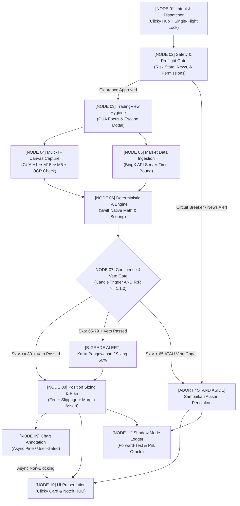

# Cetak Biru Alur Kerja Node-by-Node: Futures Scout (CUA + Astronacci Engine)

Dokumen ini memetakan seluruh arsitektur sistem **Futures Scout** menjadi **11 Node Eksekusi Terstruktur (Directed Acyclic Graph / DAG)**. Versi ini telah disempurnakan berdasarkan hasil *stress-test & critical engineering audit* dengan mengintegrasikan sistem *Veto Gate*, sinkronisasi venue exchange, *single-flight run lock*, penanganan latensi adaptif, dan formula manajemen risiko fee/slippage yang ketat.

---

## 🗺️ 1. Peta Visual Seluruh Alur (Mermaid DAG)



---

## 📦 2. Spesifikasi Detail Per Node

---

### [NODE 01] Intent & Dispatcher (Clicky Hub + Run-Lock)
- **Tujuan**: Menangkap instruksi user dan mendelegasikannya ke Futures Scout secara terisolasi.
- **Pengaman Single-Flight (Run-Lock)**:
  - Sebelum memproses, sistem memeriksa flag `isScoutRunning`.
  - Jika proses sebelumnya masih berjalan, tolak request baru dengan pesan: *"Futures Scout sedang memproses chart. Mohon tunggu beberapa detik."* Hal ini mencegah tabrakan aksi CUA (*interleaved keystrokes*).
- **Input**:
  - `rawUserQuery: String`
  - `activeAppBundleId: String?`
- **Proses**:
  1. Parsing simbol instrumen (Default: `BTCUSDT`).
  2. Menentukan target venue seragam: `BINGX:BTCUSDT.P` (menghindari disparitas wick antar-bursa).
  3. Mengunci `isScoutRunning = true` dengan *timeout release* 25 detik.
- **Output Data Contract**:
  ```json
  {
    "traceId": "scout_20260926_104500_btc",
    "venue": "BINGX",
    "symbolTradingView": "BINGX:BTCUSDT.P",
    "symbolExchange": "BTC-USDT",
    "strategy": "ASTRONACCI_SCALPING",
    "targetTimeframes": ["60", "15", "5"],
    "requestedAtUTC": "2026-09-26T10:45:00.120Z"
  }
  ```

---

### [NODE 02] Safety, Preflight & Circuit Breaker Gateway
- **Tujuan**: Memastikan lingkungan macOS dan kondisi pasar aman sebelum mengeksekusi CUA.
- **Preflight Checks (Izin macOS)**:
  1. Cek `AXIsProcessTrusted()` (Accessibility permission untuk CUA).
  2. Cek `CGPreflightScreenCaptureAccess()` (Screen Recording permission).
  3. Jika salah satu izin mati, batalkan alur dan arahkan user ke *System Settings*.
- **Pengecekan Risiko & Jadwal**:
  1. **Daily Drawdown Check**: Baca `FuturesScoutRiskState.json` (diproduksi oleh Node 11). Jika akumulasi PnL hari ini $\le -3.0\%$, aktifkan **Lockout 24 Jam** (blokir Node 03–09).
  2. **Economic Calendar Buffer**: Cek jarak ke berita *High-Impact* (FOMC, CPI, NFP). Jika berada dalam rentang **$\pm 45$ menit**, gagalkan alur $\rightarrow$ `ABORT (News Hazard)`.
  3. **UTC Session Identification (tzdb Dynamic)**: Identifikasi sesi jam pasar menggunakan database zona waktu dinamis (mencegah bug musim dingin/DST):
     - Asia / Tokyo: 00:00 – 07:00 UTC
     - London: 07:00 – 16:00 UTC
     - New York: 12:30 – 21:00 UTC
     - *London-NY Overlap*: 12:30 – 16:00 UTC (Puncak volume likuid).
- **Output**: `ClearanceToken(isApproved: Bool, reason: String?, currentSession: String)`

---

### [NODE 03] TradingView Workspace Hygiene (Focus & State Prep)
- **Tujuan**: Menyiapkan kanvas TradingView Desktop agar bebas gangguan dan fokus berada di kanvas kandel.
- **Whitelist Keystroke & Safety Pre-check**:
  - Sistem HANYA diizinkan mengirim keystroke yang masuk dalam *Allowlist* navigasi (`Escape`, `Option+R`, `Option+W`, angka, `Return`). Dilarang keras mengirim hotkey trading order (seperti `Shift+B` / `Shift+S`).
  - Pre-check: Jika mendeteksi window *Order Panel / Broker Connection* aktif di TradingView, tolak CUA untuk mencegah eksekusi order yang tidak disengaja.
- **Langkah Tindakan**:
  1. `TradingViewInputSupport.activateTradingView()`: Bawa window ke depan.
  2. Kirim tombol `Escape` dua kali untuk memastikan textfield/dialog modal tertutup dan fokus kembali ke kanvas chart utama.
  3. Kirim `Option + R` (Reset Scale).
  4. Kirim `Option + W` (Tutup Sidebar Watchlist).
  5. Tunggu delay adaptif 600ms, verifikasi kanvas chart siap.
- **Output**: `TradingViewCanvasReadyState(windowId: Int64, bounds: CGRect, isChartFocused: true)`

---

### [NODE 04] Multi-Timeframe Canvas Capture Engine (CUA)
- **Tujuan**: Mengambil tangkapan layar H1, M15, dan M5 dengan verifikasi semantik pasca-aksi.
- **Langkah Eksekusi Adaptif**:
  1. **Sinkronisasi Simbol**: Ketik `BINGX:BTCUSDT.P` + `Return` $\rightarrow$ Tunggu 800ms.
  2. **Capture H1**: Ketik `60` + `Return` $\rightarrow$ Tunggu render stabil (800ms) $\rightarrow$ Ambil screenshot H1.
  3. **Capture M15**: Ketik `15` + `Return` $\rightarrow$ Tunggu render stabil (800ms) $\rightarrow$ Ambil screenshot M15.
  4. **Capture M5**: Ketik `5` + `Return` $\rightarrow$ Tunggu render stabil (800ms) $\rightarrow$ Ambil screenshot M5.
- **Verifikasi Semantik**:
  - Ambil crop area header chart untuk memverifikasi teks timeframe dan simbol cocok dengan target. Jika gagal, coba ulang 1 kali (retry with backoff).
- **Output**:
  ```json
  {
    "traceId": "scout_20260926_104500_btc",
    "h1ScreenshotPath": "/tmp/futures_scout/h1_canvas.png",
    "m15ScreenshotPath": "/tmp/futures_scout/m15_canvas.png",
    "m5ScreenshotPath": "/tmp/futures_scout/m5_canvas.png",
    "captureTimestampUTC": "2026-09-26T10:45:06.400Z"
  }
  ```

---

### [NODE 05] Ground-Truth Market Data Ingestion (Single Source of Truth)
- **Tujuan**: Mengambil kandel numerik eksak dari bursa via REST API terikat *Server Time*.
- **Endpoint**: BingX Perpetual Swap Public Market API (`/openApi/swap/v2/quote/klines`).
- **Proses & Validasi Ketat**:
  1. Tarik kandel H1 (200 bar), M15 (150 bar), M5 (100 bar).
  2. **Server-Time Freshness Check**: Ukur selisih waktu kandel M5 terakhir terhadap `serverTimeUTC` bursa. Usia kandel M5 yang sudah *close* wajib **$\le 60$ detik**.
  3. **Bar-Boundary Race Guard**: Jika terjadi pergantian bar kandel M5 baru di antara Node 04 dan Node 05 (selisih > 5 detik), batalkan snapshot dan sinkronkan ulang kandel.
  4. **Fallback Berjenjang**: Jika BingX API timeout (> 4s), coba Binance Futures Public API dengan penanda `basisRiskFlag = true` (-5 poin penalti pada skor konfluensi). Jika keduanya gagal $\rightarrow$ ABORT.
- **Output**:
  ```json
  {
    "traceId": "scout_20260926_104500_btc",
    "venue": "BINGX",
    "serverTimeUTC": "2026-09-26T10:45:07.100Z",
    "klineAgeSec": 7,
    "lastClosedPrice": 64720.0,
    "isClosedOnly": true
  }
  ```

---

### [NODE 06] Deterministic TA Engine (Swift Native Math)
- **Tujuan**: Menghitung indikator teknikal murni di Swift tanpa campur tangan LLM.
- **Join Policy (N4 + N5)**:
  - Pasang **Hard Timeout 8.0 detik** pada proses paralel N4 dan N5.
  - Jika screenshot N4 timeout, alur TIDAK DEADLOCK; sistem langsung menggunakan data numerik N5 secara mandiri (*Degrade Gracefully*).
- **Kalkulasi Matematis Deterministik**:
  1. **H1 Trend Regime (Bobot 25 Poin)**:
     - Hitung EMA 21, EMA 34, dan Baseline EMA 200 pada H1.
     - *Kondisi*: Harga > EMA 34 DAN EMA 21 > EMA 34 (*Slope Positif*) DAN Harga > EMA 200 $\rightarrow$ **+25 Poin**.
  2. **M15 Fibonacci Grid & Swing Detection (Bobot 25 Poin)**:
     - Jalankan algoritma **Pivot Fractal 5-Bar** (2 kandel kiri, 1 puncak, 2 kandel kanan tertutup) pada kandel close untuk menemukan titik *Swing Low* dan *Swing High*.
     - Hitung: Fib 0.382, Fib 0.500, Fib 0.618, Fib 0.786.
     - Hitung $\text{ATR}(14)$ pada M15.
     - Cek apakah harga berada di **Golden Pocket (50.0% – 61.8%)** dengan toleransi $\le 0.25 \times \text{ATR}$ $\rightarrow$ **+25 Poin**.
  3. **M5 Candlestick Trigger (Bobot 20 Poin)**:
     - Cek kandel M5 terakhir yang *close*: Ekor penolakan $\ge 2\times$ Badan kandel (Pin Bar) dengan toleransi ujung ekor $\le 0.1 \times \text{ATR}$ ATAU Bullish Engulfing $\rightarrow$ **+20 Poin**.
  4. **M5 Stochastic Oscillator (Bobot 15 Poin)**:
     - Hitung Stochastic (5, 3, 3): %K memotong %D ke atas di area $< 20$ pada kandel close $\rightarrow$ **+15 Poin**.
  5. **Waktu & Kalender (Bobot 15 Poin)**:
     - Sesi London-NY Overlap (12:30–16:00 UTC) $\rightarrow$ **+10 Poin**.
     - Bebas berita High-Impact $> 45$ menit $\rightarrow$ **+5 Poin**.
  6. **Total Score**: $\sum \text{Poin}$ (Maksimal 100 Poin).
- **Output**: Objek Swift `DeterministicAnalysisResult`.

---

### [NODE 07] Confluence & Veto Gate (Penyaringan Mutlak)
- **Tujuan**: Menerapkan aturan veto keras dan menyaring setup yang tidak memenuhi kriteria.
- **Aturan Veto Keras (Hard Conjunction Veto)**:
  Walaupun skor aditif mencapai angka 80, setup **GUGUR OTOMATIS (ABORT)** jika salah satu dari kondisi berikut terjadi:
  - ❌ `candleTrigger == .none` (Tidak ada kandel pembalikan arah terkonfirmasi di M5 searah tren).
  - ❌ `calculatedRR < 1:1.0` (Rasio Risk-to-Reward ke TP1 di bawah standar minimum 1:1.0 Re-test Swing High).
  - ❌ `riskDist < 0.5 * ATR(14)` (Jarak stop loss terlalu sempit/mikro, berisiko memicu lonjakan leverage semu dan stop-out prematur).
  - ❌ `detectedRegime == .choppy` (Rezim pasar choppy/sideways dilarang membuka posisi terarah).
  - ❌ `fractals == nil` (Tidak ada ayunan 5-bar pivot fractal terkonfirmasi; sistem dilarang mengarang swing sintetis).
- **Semantik Ambang Skor yang Disatukan**:
  - **Skor $\ge 80$ + Veto Passed**: **A-Grade Setup** $\rightarrow$ Lanjut ke Node 08 (Full Sizing 1.0% Risk, `isBGradeHalfSize = false`).
  - **Skor $65 - 79$ + Veto Passed**: **B-Grade Setup** $\rightarrow$ Lanjut ke Node 08 dengan label `High Risk` dan ukuran posisi dipotong otomatis menjadi **50% (0.5% risk)**.
  - **Skor $< 65$ ATAU Veto Gagal**: **STAND ASIDE / NO TRADE** $\rightarrow$ Belokkan alur ke ABORT (`tradePlan = nil`).

---

### [NODE 08] Risk-Adjusted Sizing & Plan Synthesis
- **Tujuan**: Menghitung Stop Loss, Take Profit, dan ukuran kontrak dengan penyangga fee dan slippage.
- **Formula Stop Loss Struktural (Opsi A Canon)**:
  - Ditarik di bawah/atas level ekstrem ayunan impulsif utama (*Swing Low / Swing High*) dengan penyangga:
    $$\text{SL} = \text{Swing Low/High} \mp (0.25 \times \text{ATR}(14))$$
- **Formula Sizing Terkalibrasi**:
  $$\text{Size} = \frac{\text{Equity} \times \text{RiskPct}}{|\text{Entry} - \text{SL}| + \text{feeBuffer} + \text{assumedSlippage}}$$
  - `feeBuffer` = $\text{Entry} \times 0.001$ ($0.1\%$ taker fee round-trip).
  - `assumedSlippage` = $0.1 \times \text{ATR}(14)$ (mengantisipasi lonjakan kandel cepat).
  - *Asersi Margin*: Sistem memastikan $\text{Notional} = \text{Size} \times \text{Entry} \le \text{Equity} \times \text{MaxLeverage (10x)}$.
- **Target Exit Dua Tahap (Sub-Ablasi 2a Canon)**:
  - **TP1**: Level *Previous Swing High / Low* (1.0 Retest) dengan R:R minimal $1 : 1.0$ (50% posisi $\rightarrow$ Begitu tersentuh, kunci realized profit dan geser SL ke BEP).
  - **TP2**: Level Fibonacci Expansion 1.272 s/d 1.618 (50% sisa posisi).
- **Output**: Objek data `SynthesizedTradePlan`.

---

### [NODE 09] Chart Annotation (Pine Script v5 - Async & User-Gated)
- **Tujuan**: Menggambar zona Golden Pocket dan garis SL/TP di chart TradingView secara aman.
- **Karakter Non-Blocking**:
  - Node 09 berjalan secara *async non-blocking* dan tidak menghambat Node 10 (kartu UI langsung muncul tanpa menunggu CUA selesai menggambar).
- **Restorasi Clipboard Pengguna**:
  - CUA mencadangkan isi clipboard lama user (`NSPasteboard.general`).
  - Menempelkan Pine Script ke Pine Editor (`Option + E` $\rightarrow$ `Cmd + Return`).
  - Mengembalikan isi clipboard lama user seketika setelah paste selesai.

---

### [NODE 10] UI Presentation (Clicky Floating Card & Notch HUD)
- **Tujuan**: Menampilkan kartu rencana trading di UI Clicky / Notch.
- **Komponen Tampilan**:
  - Badge Header: `⚡ FUTURES SCOUT • A-GRADE (85/100)` atau `⚠️ B-GRADE (72/100)`.
  - Detail Rencana: Entry Limit, Stop Loss (Structural Swing Low/High $\pm$ 0.25 ATR), TP1 (1.0 Retest), TP2 (Exp 1.272).
  - Ukuran Posisi: Alokasi Lot yang dihitung aman sesuai risiko 1%.
  - Tombol: `[ ↗ Show on Chart ]`, `[ 📋 Salin Rencana ]`, `[ ✕ Tutup ]`.
  - Audio TTS: Clicky membacakan pengumuman ringkas satu kalimat.

---

### [NODE 11] Shadow Mode Logger & Forward-Test Tracker
- **Tujuan**: Mencatat seluruh keputusan (baik yang dieksekusi maupun yang di-abort) ke dalam jurnal paper trading otomatis sebagai *Oracle PnL*.
- **Berkas Log**: `FuturesScoutPaperTrades.jsonl`.
- **Fill-Model Konservatif**:
  - Order Limit dianggap masuk (*filled*) hanya jika harga pasar menembus level entry minimal $1 \text{ tick}$.
  - Stop Loss diasumsikan terkena penalti slippage $+0.05\%$.
  - Durasi pemantauan diperpanjang hingga **72 bar M5 (6 jam)** (Intraday Scalp-Swing) untuk memberi ruang bagi pergerakan impulsif penuh, ditambah pemotongan biaya *Funding Rate* 8 jam (0.01%).
- **Kriteria Promosi ke Mode Aktif**:
  - Minimal $n \ge 100$ transaksi tercatat di jurnal (dicapai via multi-aset BTC/ETH/SOL setelah edge gross terbukti).
  - *Gross Expectancy* $> 0$ pada Out-of-Sample.
  - *Profit Factor* $> 1.30$.
  - *Maximum Drawdown* simulasi $< 6.0\%$.
- **Penyedia Data PnL Harian (Oracle)**:
  - Akumulasi PnL dari Node 11 secara otomatis memperbarui status `FuturesScoutRiskState.json` setiap akhir hari (reset pukul 00:00 UTC) untuk mengaktifkan Circuit Breaker jika terjadi kerugian $-3.0\%$.

---

## 🛡️ 3. Matriks Penanganan Kegagalan & Fallback (Final)

| Titik Kegagalan | Potensi Dampak | Mekanisme Mitigasi & Fallback |
| :--- | :--- | :--- |
| **Request Scout Dobel (Spam)** | Keystroke CUA tabrakan / acak. | Single-flight run lock di Node 01 menolak request kedua hingga proses pertama tuntas. |
| **Izin macOS Hilang (AX/Screen)** | CUA gagal tanpa pesan (*silent fail*). | Preflight check Node 02 memverifikasi izin dan memunculkan dialog panduan ke System Settings. |
| **Teks Masih Aktif di Search Box** | Hotkey `Option+W` mengetik karakter "∑". | Node 03 selalu menekan `Escape` dua kali untuk memastikan kanvas chart memegang fokus keyboard. |
| **Screenshot Node 04 Timeout (> 8s)** | Pipeline CUA menggantung. | Hard timeout 8s di Node 06 memutus penantian screenshot; sistem langsung memproses data numerik API. |
| **Candle Terlewat Antara N4 & N5** | Visual kandel dan angka API beda bar. | Node 05 membandingkan timestamp kandel terhadap server time bursa; jika desync > 5 detik, lakukan re-fetch. |
| **Broker Panel Aktif di TradingView** | Risiko salah tekan order riil. | Preflight CUA Node 03 menolak mengirim keystroke jika mendeteksi panel order terbuka (Strict Read-Only). |
| **Skor 80 Tanpa Kandel Reversal** | Sinyal palsu saat pasar ekspansi tajam. | Veto gate keras di Node 07 otomatis membatalkan rencana trade tanpa memedulikan skor aditif. |
