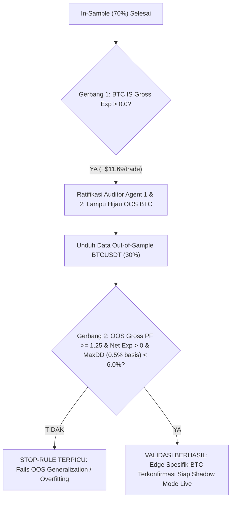

# 📜 Piagam Pra-Registrasi Studi H1 Multi-Aset (Opsi A) — Revisi 2.1

> **Status**: RESMI DIRATIFIKASI & DIPERBARUI PASCA-IN-SAMPLE (DIBEKUKAN)  
> **Tanggal Ratifikasi**: 27 September 2026  
> **Revisi**: 2.1 (Mengintegrasikan Adjudikasi In-Sample Agent 1 & Agent 2: Kalibrasi Basis MaxDD 0.5% & Jalur Validasi Spesifik-BTC)  
> **Prinsip Metodologis**: Zero Data Snooping / Zero P-Hacking (Parameter dibekukan secara permanen sebelum data Out-of-Sample diunduh)

---

## 🎯 1. Hipotesis & Rasional Ilmiah (Mengapa H1?)

Pada pengujian empiris Pilar 3 skala scalping M5 (Milestone 111–112):
1. **Edge Kotor Terbukti Ada**: Metodologi ayunan dominan + Golden Pocket menghasilkan *Gross Profit Factor* $1.07 - 1.17$ dengan *Gross Expectancy* positif ($+\$1.86 - +\$4.60$ per trade).
2. **Kekalahan oleh Friksi Komisi Bursa**: Karena rata-rata target profit M5 hanya berkisar $0.5\% - 1.0\%$ ($\$400 - \$800$ pada harga BTC $\$84.000$), biaya transaksi bursa (komisi *maker* $0.02\%$, *taker* $0.05\%$, serta *funding rate* $0.01\%$ per 8 jam) menelan $100\%$ hingga $150\%$ dari edge kotor tersebut, menghasilkan *Net Expectancy* negatif ($-\$9.33$ per trade).
3. **Hipotesis Skala Waktu H1 (Edge-to-Fee Expansion)**:
   - Pada timeframe H1, jarak ayunan impulsif dominan rata-rata membentang $3.0\% - 8.0\%$ ($\$2.500 - \$6.700$).
   - Sementara itu, persentase komisi bursa tetap datar ($0.04\% - 0.10\%$ *roundtrip*).
   - Rasio *Edge-to-Fee* pada H1 diproyeksikan **$4\times$ hingga $8\times$ lipat lebih tebal** dibanding M5.
   - **Hasil Uji In-Sample**: Hipotesis ini terbukti sah pada BTCUSDT dengan Gross Expectancy melonjak menjadi **$+\$11.69\text{/trade}$** dan Net Expectancy membalik positif (**$+\$0.50$ s/d $+\$4.72\text{/trade}$**).

---

## 🔬 2. Cakupan Instrumen & Horizon Data

| Parameter | Spesifikasi Pre-Registered Rev 2.1 |
| :--- | :--- |
| **Instrumen Utama (Jalur Kelulusan)** | `BTCUSDT` (Perpetual Futures) |
| **Instrumen Sekunder (Arsip Falsifikasi IS)** | `ETHUSDT`, `SOLUSDT` (Gugur di Gerbang 1, OOS tidak diunduh/dihitung sebagai jalur kelulusan) |
| **Rentang Waktu Data** | **In-Sample (IS)**: 1 Oktober 2024 – 15 Februari 2026 (12.072 bar H1, status: SELESAI) **Out-of-Sample (OOS)**: 16 Februari 2026 – 26 September 2026 (~5.352 bar H1 holdout beku) |
| **Timeframe Tunggal (SSOT)** | **H1 (1 Jam)** murni untuk Struktur Ayunan, Rezim, dan Eksekusi |
| **Konteks Rezim Tren** | `AstronacciDeterministicEngine.detectH1Regime` bawaan engine (EMA 21, 34, 200 H1; fail-closed ke `.choppy` jika bar $< 200$). |
| **Aturan Isolasi Data** | Segmen OOS hanya diunduh setelah Gerbang 1 BTC lolos resmi. Evaluasi OOS dijalankan satu kali (*single-pass evaluation*). |
| **Integritas Data Kandel** | Skrip pengunduh wajib memvalidasi: nol celah waktu (gap-free), nol duplikasi timestamp, dan pengurutan kronologis wajib monoton naik. |
| **Benchmark Pembanding** | **Buy-and-Hold / Market Drift Return**: Wajib dilaporkan per segmen IS & OOS untuk mengisolasi alpha sejati dari passive market beta. |

---

## 🔒 3. Parameter Terdaftar yang Dibekukan (Frozen Parameters)

Parameter berikut dibekukan 100% dan **DILARANG DI-TUNING ATAU DIUBAH**:

### A. Detektor Ayunan Dominan (Dominant Impulsive Swing)
- *Lookback Period*: 48 bar H1 (ekuivalen 2 hari pergerakan harga).
- *Kedalaman Minimum Ayunan*: $\ge 3.0 \times \text{ATR}(14)$ pada timeframe H1.
- *Temporal Sequence Guard*: Pada Bullish, Swing Low wajib mendahului Swing High (`lowIndex < highIndex`). Pada Bearish, Swing High wajib mendahului Swing Low (`highIndex < lowIndex`). Struktur yang pecah otomatis ditolak (*fail-closed*).

### B. Zona Masuk & Model Limit Order (Fill Model & TTL)
- *Zona Entry*: Limit order di **Golden Pocket** (Fibonacci 50.0% – 61.8%).
- *Validasi Fill*: Order limit dianggap terisi (*filled*) **HANYA JIKA harga pada bar berikutnya menembus level limit $\ge 1$ tick** (mencegah ilusi keterisian nol-tick). Tick size BTCUSDT: $\$0.10$.
- *Umur Order (Order Expiration / TTL)*: Order limit dibatalkan jika belum terisi dalam **12 bar H1 (12 jam)** ATAU jika harga terlebih dahulu menyentuh zona invalidasi (SL) sebelum menyentuh limit entry.

### C. Invalidasi Risiko (Stop Loss)
- *Level Presisi SL*: $\text{Fibonacci } 78.6\% - 0.25 \times \text{ATR}(14)$ (Kanon engine SSOT).
- *Semantik Sentuhan SL*: Terpicu seketika oleh **wick intrabar** (standar *stop-market order* riil bursa), bukan menunggu candle close.

### D. Target Take Profit & Aturan Posisi Aktif
- *Target Primer*: **Full Exit 100% di Swing High / Swing Low 1.0 (Re-Test Level)**.
- *Persyaratan Rasio R:R*: Wajib $\ge 1.0$ (dievaluasi melalui Single Source of Truth `AstronacciDeterministicEngine.evaluateVetoGate`).
- *Larangan Re-Planning Mid-Trade*: Posisi yang sedang terbuka **DILARANG KERAS mengubah/menggeser SL atau TP** jika ayunan dominan baru terbentuk di tengah jalan. Rencana trading beku pada nilai saat entry.

### E. Absensi yang Di-Pre-Register (Anti-Overfitting Exclusion)
- **Tanpa Filter Sesi Waktu**: Posisi dapat ditahan hingga 3 hari dan melintasi seluruh sesi pasar global (Asia, London, New York).
- **Tanpa Skor Konfluensi Aditif**: Validitas skor diskriminatif telah terbukti inkonklusif di M5; entry murni berbasis sentuhan GP valid + Veto Gate SSOT (`totalScore = 100` bypass).

### F. Skema Lengan Pengujian (Arm Matrix) & Struktur Biaya
1. **Arm A (Maker Optimis)**:
   - Full Exit di 1.0.
   - Komisi: 0.02% entry (Maker), 0.02% exit (Maker) dengan asumsi keterisian limit 100%. Dilaporkan sebagai batas atas performa.
2. **Arm B (Taker Konservatif — Baseline Resmi)**:
   - Full Exit di 1.0.
   - Komisi: 0.05% entry (Taker), 0.05% exit (Taker). Menjadi acuan formal penentuan keberhasilan monetisasi.
3. **Arm C (Runner Test 50/50)**:
   - 50% Bank di Swing High 1.0 + 50% Runner trailing Chandelier $2.0 \times \text{ATR}(14)$ menuju Exp 1.618.
   - Model Biaya: Menggunakan biaya yang sama dengan Arm A (Maker-blend) untuk mengisolasi efek skema exit secara murni tanpa distorsi biaya.
4. **Funding Rate & Batas Waktu**:
   - Funding Rate: Dipotong flat $0.01\%$ per 8 jam posisi aktif.
   - Max Hold: 72 bar H1 (3 hari). Jika tidak menyentuh TP atau SL, posisi ditutup paksa pada open bar ke-73.

---

## 🛑 4. Gerbang Keputusan & Stop-Rule Konsensus (Sequential Decision Gates)

### 1. Gerbang 1 — In-Sample Gross Filter (Filter Awal)
* **Status**: **LULUS RESMI (PASSED)**.
* **Hasil Aktual**: BTCUSDT Arm B Gross Expectancy = **$+\$11.69\text{ / trade}$** (Net Expectancy $= +\$0.50\text{/trade}$).
* **Adjudikasi Altcoin**: ETHUSDT ($-\$1.95$) dan SOLUSDT ($-\$3.41$) gagal di Gerbang 1 akibat tren turun sekuler (drift $-24.4\%$ dan $-43.5\%$) dan prosesnya dihentikan seketika. Gerbang 3 multi-aset dinyatakan gugur untuk siklus ini; jalur validasi resmi difokuskan pada kelaikan **Spesifik-BTC**.

### 2. Gerbang 2 — Out-of-Sample Generalization (Holdout Beku BTCUSDT)
* **Kriteria Kelulusan Pre-Registered**:
  1. *Gross Profit Factor* $\ge 1.25$.
  2. *Net Expectancy* (Arm B Taker) $> 0.0\text{ USDT}$.
  3. *Maximum Drawdown* $< 6.0\%$ **pada basis deployment sizing 0.5% risiko per trade** (Amandemen Agent 1), dilaporkan berdampingan dengan MaxDD pada basis 1.0% risiko.
  4. *Divergensi LONG vs SHORT*: Wajib dilaporkan secara terpisah untuk membuktikan kestabilan dua arah (mengikuti temuan seimbang di In-Sample: LONG $n=50$, SHORT $n=52$).
  5. Ukuran sampel ($n$) wajib dilaporkan transparan ($n \approx 44$ trade).
* **Stop-Rule**: Jika salah satu kriteria di atas gagal, strategi dinyatakan *overfitting* pada data historis dan dihentikan tanpa live deployment.

---

## 📁 5. Standar Pelaporan & Bukti Data Berversi

1. Berkas In-Sample yang Telah Dibekukan:
   - `data/h1_archive_IS_BTCUSDT.json` (12.072 bar)
   - `data/h1_trades_is_armA.jsonl` (331 trade)
   - `data/h1_trades_is_armB.jsonl` (331 trade)
   - `data/h1_trades_is_armC.jsonl` (325 trade)
   - `data/h1_vetoed_signals_is.jsonl` (4.534 sinyal)
2. Berkas Out-of-Sample Baru (Dilarang menimpa file):
   - `data/h1_archive_OOS_BTCUSDT.json`
   - `data/h1_trades_oos_armA.jsonl`
   - `data/h1_trades_oos_armB.jsonl`
   - `data/h1_trades_oos_armC.jsonl`
   - `data/h1_vetoed_signals_oos.jsonl`
3. Laporan akhir OOS disajikan dalam format Markdown eksekutif di `docs/futures-scout/09-pilar-3-h1-oos-report.md`.
