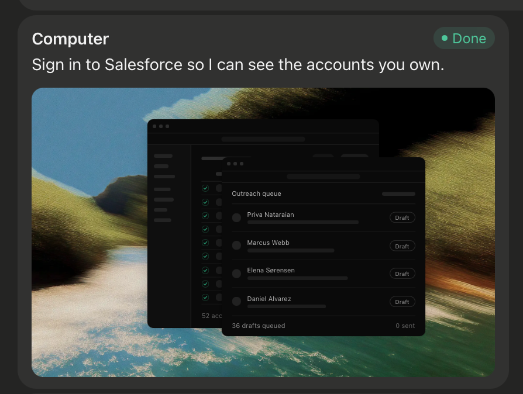

# 01. Grok Bot Deconstruction: Analisis Mendalam Arsitektur xAI × Cursor

<!-- Status: Technical Reference & Deconstruction -->
<!-- Sources: docs.x.ai/grok-bot, x.ai/bot, docs.x.ai/developers/tools/function-calling -->
<!-- Date: September 2026 -->

---

## 🔬 1. Paradigma Utama: Teammate Bukan Chatbot

xAI Grok Bot merevolusi interaksi AI dengan mendefinisikan ulang unit dasarnya:
- **Chatbot Konvensional**: Model pasif *stateless* yang merespons teks dengan teks atau kode draf, lalu berhenti dan menunggu input pengguna berikutnya. Semua eksekusi nyata dibebankan kepada manusia.
- **Grok Bot (AI Teammate)**: Agen aktif *stateful* yang memiliki nama, peran (*role*), batasan izin (*approval boundaries*), memori jangka panjang, dan akses langsung ke sistem eksekusi nyata (*real computer tools*). Ketika diberi tugas, ia menyelesaikan pekerjaan dari hulu ke hilir (*end-to-end*).

```mermaid
flowchart TD
    subgraph HumanUser["Pengguna (Desktop / iOS)"]
        TaskPrompt["Pemberian Tugas: Outcome & Boundary"]
        TakeoverUI["Human Takeover: 2FA / Login / Review Draft"]
    end

    subgraph GrokBotSystem["Grok Bot Runtime"]
        BotPersona["Bot Persona (Role, Memory, Boundaries)"]
        Planner["Reasoning Engine (Grok-4.7 / Grok-Build)"]
        ToolRouter{"Tool Router"}
        FunctionCalling["Structured Connectors (JSON Schema APIs)"]
        ComputerUse["Computer Use (Virtual Display / Browser)"]
        RoutinesScheduler["Routines & Scheduled Automations"]
    end

    subgraph ExecutionEnvironment["Persistent Computer Sandbox"]
        SharedWorkspace["Shared Filesystem (/workspace)"]
        VirtualDisplay["Isolated Screen & Window Manager"]
        BrowserSession["Persistent Headless Browser Profiles"]
        TerminalCLI["Bash Terminal & Shell Environment"]
    end

    TaskPrompt --> BotPersona --> Planner --> ToolRouter
    ToolRouter -->|Structured API| FunctionCalling
    ToolRouter -->|UI Interaction| ComputerUse
    ComputerUse --> VirtualDisplay
    FunctionCalling --> SharedWorkspace
    ComputerUse --> BrowserSession
    RoutinesScheduler --> Planner
    VirtualDisplay -.->|Streaming Snapshot Card (Foto 1)| HumanUser
    TakeoverUI -.->|Direct Credential Injection| BrowserSession
```

---

## 🖥️ 2. Arsitektur "Each Bot Has a Computer"

Satu poin kunci yang diungkapkan dokumentasi resmi xAI:
> *"Each Bot works on a persistent cloud computer with a browser, filesystem, and terminal... All of your Bots use the same cloud computer, sharing its files, browser sessions, and app logins, which makes handoffs work without repeating setup."*

### Karakteristik Teknis Lingkungan Komputer:
1. **Persistent Cloud Computer**: Setiap akun memiliki sebuah mesin virtual persisten (berbasis Linux di cloud Cursor). Komputer ini terus bekerja meskipun laptop pengguna ditutup (*clamshell closed*).
2. **Dedicated Screen per Bot**: Meskipun mesin fisiknya satu (per akun), setiap Bot memiliki layar/workspace virtual tersendiri (*"Each Bot gets its own screen on the shared computer"*). Satu Bot menjalankan satu tugas Computer Use di layarnya pada satu waktu.
3. **Shared Browser State**: Sekali pengguna login ke sebuah web service (misalnya Salesforce, Gmail, LinkedIn) di browser komputer tersebut, sesi cookie dan autentikasinya persisten dan dapat diakses oleh Bot lain tanpa perlu login ulang.
4. **Shared Workspace Filesystem (`/workspace`)**: Semua berkas hasil kerja (dokumen, draf email, spreadsheet, kode) disimpan di direktori terpusat `/workspace`, memungkinkan Bot berikutnya melanjutkan pekerjaan dari berkas tersebut.

---

## 🖼️ 3. Bedah Anatomi Kartu Chat "Computer" (Analisis Foto 1)

Foto 1 yang diunggah pengguna menunjukkan antarmuka kartu chat paling ikonik dari Grok Bot:



### Elemen-Elemen Kartu:
1. **Header Bar**:
   - Ikon & Label: `Computer` (menandakan aksi ini berjalan di lingkungan komputasi visual, bukan sekadar respons teks).
   - Status Pill:
     - ` Working` (dengan spinner/pulse animasi saat Bot sedang mengoperasikan jendela).
     - `• Done` (hijau solid saat tugas selesai).
     - `• Needs Approval` / `• Take Over` (oranye/kuning saat terbentur autentikasi).
2. **Action / Requirement Message**:
   - Teks instruksi langsung: *"Sign in to Salesforce so I can see the accounts you own."*
   - Memberitahu pengguna dengan tepat apa yang sedang dibutuhkan agen untuk melanjutkan.
3. **Embedded Visual Canvas Frame**:
   - Menampilkan tangkapan layar dinamis (*live frame buffer streaming*) dari desktop virtual komputer tersebut.
   - Di foto terlihat: Wallpaper lanskap gunung/danau dengan 2 jendela aplikasi dark-mode melayang:
     - Jendela latar belakang: Dashboard Salesforce/CRM.
     - Jendela depan: Antarmuka antrian penjangkauan (*Outreach queue*) yang memuat daftar prospek (Priya Natarajan, Marcus Webb, Elena Sørensen, Daniel Alvarez) dengan status `Draft`.
   - Footer mini di dalam frame: *52 accounts, 36 drafts queued, 0 sent*.
4. **Protokol Human Takeover**:
   - Jika situs web membutuhkan password, 2FA, atau CAPTCHA, Bot tidak menebak dan dilarang meminta password lewat chat teks.
   - Bot memunculkan kontrol *Take Over*. Pengguna mengklik kartu untuk mengendalikan kursor mouse di dalam jendela virtual tersebut, menyelesaikan 2FA, lalu mengklik *Release / Continue*. Bot seketika melanjutkan tugas secara otonom.

---

## ⚡ 4. Function Calling vs Computer Use: Pendekatan Dual-Engine

Grok Bot tidak menggunakan Computer Use (klik mouse visual) untuk semua hal. Dokumentasi xAI secara eksplisit menyatakan:
> *"Prefer a connector when one is available: it is often more reliable than clicking through a website. Use the browser for services without a connector or for visual workflows a connector does not expose."*

### Tabel Perbandingan Peran Engine:

| Fitur | Function Calling (Connectors) | Computer Use (Visual CUA) |
| :--- | :--- | :--- |
| **Karakteristik** | Terstruktur, deterministik, berbasis API JSON Schema. | Fleksibel, visual, interaktif berbasis piksel & DOM. |
| **Kecepatan & Biaya** | Sangat cepat (< 500ms per panggilan), hemat token konteks. | Lebih lambat (1–3s per langkah per tangkapan layar), konsumsi token visi lebih besar. |
| **Keandalan** | 99.9% deterministik; tidak terpengaruh perubahan layout CSS atau pop-up. | Rentan terhadap pop-up, modal tak terduga, atau animasi. |
| **Kapan Digunakan** | Mengambil 52 akun dari CRM, membaca kandel OHLC BingX, query basis data, manipulasi berkas disk. | Mengoperasikan aplikasi desktop proprietary tanpa API publik (misal TradingView desktop), navigasi web visual kompleks. |

---

## 🔄 5. Mesin Rutinitas (Skills, Routines & Automations)

Fitur unggulan Grok Bot adalah kemampuan mengubah demonstrasi menjadi automasi terjadwal:
1. **Teach a Task ("Show a Bot how it's done")**:
   - Pengguna merekam alur kerja satu kali.
   - Bot mencatat urutan tool calls dan navigasi, menyimpulkannya menjadi sebuah *Skill* terdaftar (misal `/weekly-pipeline-review`).
2. **Routines & Scheduling**:
   - Bot dapat menjalankan rutinitas secara berkala (misal: *"Run this every week"* atau *"Generate pipeline overnight"*).
   - Setiap Bot dapat memiliki hingga 50 rutinitas aktif dengan riwayat 20 eksekusi terakhir.
3. **Approval Boundary**:
   - Rutinitas selalu memisahkan tahap persiapan (*drafting/reconciliation*) dari eksekusi eksternal (*sending/publishing/paying*).
   - Hasil akhir diletakkan dalam antrian draf (*review queue*) agar pengguna memeriksa dan menyetujui sebelum tindakan permanen terjadi.

---

## 👥 6. Kolaborasi Multi-Bot (Team Bots & Group Chat)

Grok Bot mendukung ekosistem tim agen:
1. **Spesialisasi Peran**: Daripada 1 bot serba tahu yang membingungkan (*"General Helper"*), disarankan membuat bot spesialis: *Sales Outbound*, *Bug Reproduction*, *Expense Manager*, *Chief of Staff*, atau *Market Analyst*.
2. **Group Chats**: Pengguna dapat memasukkan 2 hingga 6 Bot ke dalam satu thread chat.
   - Pengguna dapat mengetik: *"@Researcher kumpulkan data koin, @Analyst periksa Fibonacci GP, @RiskManager evaluasi SL"*.
   - Bot saling melempar pesan asinkron (*handoff*) tanpa pengguna harus meng-copy-paste output satu bot ke bot lainnya.
3. **Penyimpanan Memori & Berkas Bersama**:
   - Memori percakapan bersifat privat per Bot.
   - Namun, berkas di `/workspace` dapat dibaca dan diedit bersama, menjadi jembatan artefak nyata antar-rekan kerja.

---

## 🛡️ 7. Tata Kelola Keamanan: Auto-Review & Kebijakan Eksekusi Lokal

Dokumentasi *Approvals, Security and Privacy* xAI mengungkap sistem kendali keamanan yang sangat krusial:
1. **Engine Auto-Review (Aturan Evaluasi Otomatis)**:
   - Evaluasi setiap *tool call* dan tindakan komputer sebelum dieksekusi.
   - **Aturan `Ask first`**: Menghentikan aksi dan mewajibkan izin manual (misal: mengirim email eksternal, mengeksekusi order trading nyata, mengubah data produksi).
   - **Aturan `Allow automatically`**: Mengizinkan aksi berjalan tanpa jeda jika tidak melanggar aturan lain (misal: `git status`, membaca kandel pasar, kalkulasi Fibonacci).
   - *Prinsip Prioritas*: Jika kedua aturan cocok, `Ask first` **selalu menang**.
2. **Secret Masking & Field Rahasia**:
   - Ketika bot membutuhkan kredensial (API Key, password, token), bot **dilarang menerima rahasia via teks chat biasa**.
   - Sistem merender komponen input khusus terisolasi (*masked secret input field*). Nilai rahasia dimaskir (*bullet points*), diabaikan dari transkrip chat, dan tidak pernah diumpankan ke context window LLM.
3. **Kebijakan Akses Komputer Lokal (*Local Computer Permissions*)**:
   - Membedakan antara lingkungan sandbox cloud dengan komputer fisik pengguna (Mac host).
   - Opsi izin eksekusi lokal: `Ask every time` (Default), `Always allow`, dan `Never allow`.
   - Hal ini relevan bagi Izanotchy yang berjalan langsung di macOS native.

---

## 📁 8. Manajemen Berkas & Bukti Faktual (Files, Results & Evidence Preservation)

Dokumentasi *Files and Results* xAI menetapkan standar integritas hasil kerja:
1. **Pemisahan Deliverables vs Scratchpad**:
   - Berkas hasil final (laporan analisis, skrip Pine Script, draf email) disimpan di direktori terstruktur `/workspace/deliverables/`.
   - Berkas perantara atau cache sementara diletakkan di `/workspace/scratchpad/` dan dapat dibersihkan secara aman.
2. **Preservasi Bukti (*Evidence Preservation*)**:
   - Setiap tindakan otonom yang diklaim selesai **wajib menyertakan bukti faktual**:
     * Tangkapan layar (*screenshot*) dengan state elemen yang relevan.
     * Tautan sumber data (*direct source links*) atau ID entitas.
     * Timestamp dan zona waktu eksekusi yang jelas.
     * Log tindakan ringkas (*concise action log*).
     * Daftar eksplisit hal-hal yang **tidak dapat diverifikasi** oleh bot (*unverified items list*).
   - Sikap jujur ini menghindarkan bot dari halusinasi atau klaim palsu atas tindakan yang belum diverifikasi.

