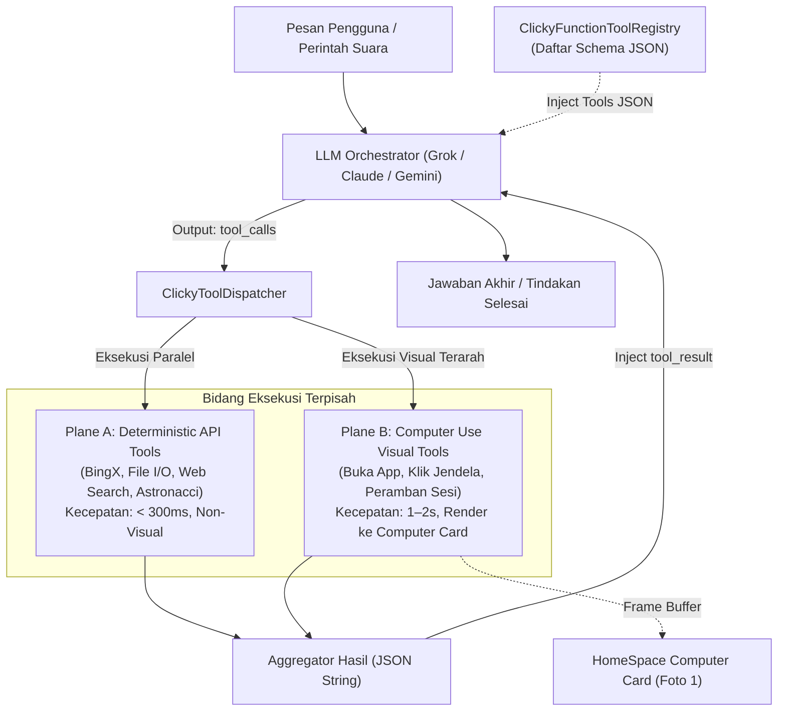

# 03. Function Calling Specification: Adopsi Standar xAI ke Izanotchy

<!-- Status: Technical Architecture & API Blueprint -->
<!-- Reference: https://docs.x.ai/developers/tools/function-calling -->
<!-- Date: September 2026 -->

---

## 🎯 1. Filosofi & Standar xAI Function Calling

Dokumentasi resmi xAI menetapkan standar industri untuk pemanggilan fungsi (*function calling*):
- **Deklarasi Berbasis JSON Schema**: Setiap alat (*tool*) didefinisikan dengan nama unik, deskripsi perilaku, dan skema parameter bertipe kuat (*type-safe schema*).
- **Akar Skema Wajib Objek**: Parameter JSON Schema harus bertipe `"type": "object"` di level teratas.
- **Eksekusi Paralel (*Parallel Function Calling*)**: Model dapat meminta beberapa pemanggilan fungsi sekaligus dalam 1 turn respons (misal: mengambil data koin BTC dan ETH secara simultan).
- **Dua Kategori Alat**:
  1. *Built-in Tools* (seperti `web_search`, `x_search`) yang berjalan otomatis di backend.
  2. *Custom Tools* yang menghentikan sejenak siklus generasi (*pause*), meminta lingkungan klien (Izanotchy) untuk mengeksekusi, lalu melanjutkan percakapan dengan `tool_result`.

---

## 🏗️ 2. Arsitektur Engine Function Calling di Izanotchy

Untuk mengadopsi standar xAI secara native di Swift, kita merancang subsistem terpusat: `ClickyFunctionToolRegistry`.



---

## 📋 3. Protokol Swift: `ClickyFunctionTool`

Setiap tool di Izanotchy mengadopsi protokol terstandarisasi yang menghasilkan skema JSON kompatibel xAI:

```swift
import Foundation

public struct ClickyToolResult: Codable {
    public let callId: String
    public let name: String
    public let output: String
    public let isError: Bool
    public let visualSnapshotPath: String? // Jika tool menghasilkan perubahan visual pada jendela
    
    public init(callId: String, name: String, output: String, isError: Bool = false, visualSnapshotPath: String? = nil) {
        self.callId = callId
        self.name = name
        self.output = output
        self.isError = isError
        self.visualSnapshotPath = visualSnapshotPath
    }
}

public protocol ClickyFunctionTool: Sendable {
    var name: String { get }
    var description: String { get }
    var parametersSchema: [String: Any] { get }
    var requiresApproval: Bool { get }
    var category: ClickyToolCategory { get }
    
    func execute(callId: String, arguments: [String: Any], context: CompanionExecutionContext) async throws -> ClickyToolResult
}

public enum ClickyToolCategory: String, Codable {
    case marketData = "market_data"
    case desktopWorkspace = "desktop_workspace"
    case fileManagement = "file_management"
    case webResearch = "web_research"
    case interCompanion = "inter_companion"
}
```

---

## 🛠️ 4. Katalog Tools Standar xAI yang Diadopsi ke Izanotchy

### A. Kategori API Deterministik (Plane A - Cepat & Tanpa Gangguan Layar)

#### 1. `get_crypto_market_analysis` (Pengganti hardcode analyzer)
- **Deskripsi**: *"Menganalisis struktur pasar kripto, kandel OHLCV, Golden Pocket Fibonacci 0.618-0.65, divergensi RSI, dan aspek ephemeris untuk sebuah simbol futures."*
- **Skema Parameter (JSON Schema)**:
  ```json
  {
    "type": "object",
    "properties": {
      "symbol": {
        "type": "string",
        "description": "Simbol trading pasangan USDT, contoh: 'BTC', 'ETH', 'SOL'"
      },
      "timeframe": {
        "type": "string",
        "enum": ["15m", "1h", "4h", "1d"],
        "default": "4h",
        "description": "Jangka waktu kandel untuk kalkulasi Fibonacci dan tren"
      }
    },
    "required": ["symbol"]
  }
  ```

#### 2. `workspace_file_operation`
- **Deskripsi**: *"Membaca, menulis, atau mendaftar berkas di dalam direktori kerja terisolasi companion (~/.izanotchy/companions/<slug>/workspace)."*
- **Skema Parameter**:
  ```json
  {
    "type": "object",
    "properties": {
      "action": {
        "type": "string",
        "enum": ["read", "write", "list", "delete"]
      },
      "relative_path": {
        "type": "string",
        "description": "Path berkas relatif terhadap direktori workspace companion"
      },
      "content": {
        "type": "string",
        "description": "Isi teks berkas jika aksi adalah 'write'"
      }
    },
    "required": ["action", "relative_path"]
  }
  ```

---

### B. Kategori Visual & Window Workspace (Plane B - Update ke Computer Card Foto 1)

#### 3. `open_companion_application`
- **Deskripsi**: *"Membuka atau menfokuskan jendela aplikasi desktop tertentu di ruang kerja companion dan mengambil snapshot tampilannya."*
- **Skema Parameter**:
  ```json
  {
    "type": "object",
    "properties": {
      "app_bundle_id": {
        "type": "string",
        "description": "Bundle identifier macOS, contoh: 'com.tradingview.tradingviewdesktop' atau 'com.apple.Safari'"
      },
      "workspace_mode": {
        "type": "string",
        "enum": ["isolated_window", "dedicated_space", "fullscreen"],
        "default": "isolated_window"
      }
    },
    "required": ["app_bundle_id"]
  }
  ```

#### 4. `request_human_takeover` (Protokol 2FA / Login Foto 1)
- **Deskripsi**: *"Meminta pengguna mengambil alih kendali jendela untuk melakukan langkah sensitif (2FA, CAPTCHA, input password atau pembayaran)."*
- **Skema Parameter**:
  ```json
  {
    "type": "object",
    "properties": {
      "service_name": {
        "type": "string",
        "description": "Nama layanan yang membutuhkan login, misal: 'Salesforce', 'Binance', 'Gmail'"
      },
      "reason": {
        "type": "string",
        "description": "Alasan pengambilalihan, contoh: 'Sign in to Salesforce so I can see the accounts you own.'"
      },
      "blocking_window_id": {
        "type": "integer",
        "description": "ID jendela CGWindowID yang memerlukan interaksi pengguna"
      }
    },
    "required": ["service_name", "reason"]
  }
  ```

---

## ⚡ 5. Siklus Penanganan Paralel (*Parallel Function Execution*)

Sesuai spesifikasi xAI, model dapat mengeluarkan beberapa `tool_calls` dalam satu balasan. Izanotchy mengeksekusinya secara paralel menggunakan Swift `TaskGroup`:

```swift
public final class ClickyToolDispatcher {
    public static let shared = ClickyToolDispatcher()
    
    public func dispatch(toolCalls: [GrokToolCall], context: CompanionExecutionContext) async -> [ClickyToolResult] {
        await withTaskGroup(of: ClickyToolResult.self) { group in
            for call in toolCalls {
                group.addTask {
                    guard let tool = ClickyFunctionToolRegistry.shared.tool(named: call.function.name) else {
                        return ClickyToolResult(callId: call.id, name: call.function.name, output: "Error: Tool not found", isError: true)
                    }
                    
                    do {
                        let parsedArgs = try JSONSerialization.jsonObject(with: Data(call.function.arguments.utf8)) as? [String: Any] ?? [:]
                        return try await tool.execute(callId: call.id, arguments: parsedArgs, context: context)
                    } catch {
                        return ClickyToolResult(callId: call.id, name: call.function.name, output: "Execution failed: \(error.localizedDescription)", isError: true)
                    }
                }
            }
            
            var results: [ClickyToolResult] = []
            for await res in group {
                results.append(res)
            }
            return results
        }
    }
}
```

Format ini memberikan paritas penuh dengan standar xAI API, memungkinkan kita menghubungkan Grok-4.7, Claude 3.7 Sonnet, ataupun model open-source tanpa perlu merombak logika eksekusi di klien Izanotchy.
