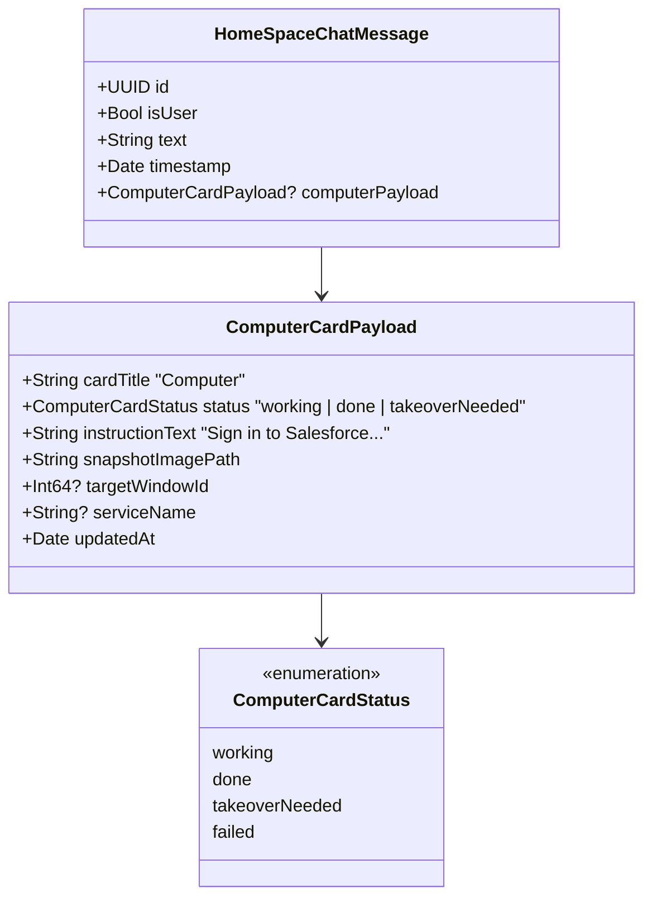

# 04. Companion Workspace Architecture: Ruang Kerja Mandiri & Kartu "Computer" (1:1 Foto 1)

<!-- Status: Native macOS Architectural Design -->
<!-- Target: Per-Companion Workspace Isolation & Interactive Streaming Card -->
<!-- Date: September 2026 -->

---

## 🎯 1. Menjawab Kebutuhan Inti Pengguna

Pengguna secara spesifik mengutarakan:
> *"Clicky kita belum jelas konsep per companion-nya... kalau saya lihat pokoknya 1 bot itu bisa buka aplikasi seperti di foto 1, terus dia bisa kerja di workspace tersebut."*

Di Grok Bot, setiap Bot memiliki "Computer" sendiri. Di macOS lokal, kita tidak perlu menyewa server cloud mahal untuk menghadirkan pengalaman ini. Kita dapat membangun **Native macOS Companion Workspace Engine** yang memberikan ilusi dan fungsionalitas 100% identik:
1. **Setiap Companion Memiliki Ruang Kerja Persisten Terisolasi** (berkas, sesi peramban, dan memori).
2. **Setiap Companion Memiliki Target Jendela / Ruang Kerja Aplikasi Sendiri**.
3. **Kartu Chat "Computer" 1:1 Foto 1** yang menampilkan status, teks instruksi, dan siaran langsung (*frame snapshot*) jendela yang sedang dikerjakan companion di dalam thread chat.
4. **Protokol Human Takeover** yang elegan untuk mengatasi login 2FA atau CAPTCHA.

---

## 📐 2. Struktur Direktori Ruang Kerja Per-Companion

Di dalam `~/.izanotchy/companions/<slug>/`, kita memperluas struktur direktori dari sekadar berkas markdown menjadi **Environment Container**:

```text
~/.izanotchy/
├── shared_workspace/                  <-- Shared filesystem (/workspace seperti Grok Bot)
│   ├── deliverables/                  <-- Hasil akhir yang bisa dibaca semua companion
│   └── scratchpad/                    <-- Berkas sementara lintas bot
└── companions/
    ├── research-buddy/
    │   ├── profile.json               <-- Nama, slug, tema warna, avatar
    │   ├── persona.md                 <-- Instruksi sistem & batasan aturan
    │   ├── memory.json                <-- Memori fakta & preferensi jangka panjang
    │   ├── routines.json              <-- Rutinitas terjadwal milik bot ini
    │   ├── workspace/                 <-- Direktori kerja privat bot ini
    │   └── browser_data/              <-- Isolated cookies & session storage (WebKit)
    ├── market-scout/
    │   ├── profile.json
    │   ├── persona.md
    │   ├── memory.json
    │   ├── workspace/
    │   │   ├── pine_scripts/
    │   │   └── snapshots/
    │   └── browser_data/
    └── sales-outbound/
        ├── ...
```

Dengan isolasi `browser_data/` per slug:
- Companion *Market Scout* bisa login ke akun TradingView / DexScreener tersendiri.
- Companion *Sales Outbound* bisa login ke CRM atau LinkedIn tanpa bentrok dengan sesi browsing pribadi pengguna.

---

## 🖼️ 3. Desain Komponen SwiftUI: `HomeSpaceComputerCardView` (Implementasi 1:1 Foto 1)

Foto 1 memperlihatkan kartu visual yang menyatu di dalam alur pesan chat. Kita memodelkannya ke dalam SwiftUI native:



### Kode Spesifikasi Visual Komponen SwiftUI:

```swift
import SwiftUI

public enum ComputerCardStatus: String, Codable {
    case working = "Working"
    case done = "Done"
    case takeoverNeeded = "Takeover Required"
    case failed = "Failed"
    
    public var dotColor: Color {
        switch self {
        case .working: return Color(hex: "#38BDF8") // Sky Blue
        case .done: return Color(hex: "#4ADE80")    // Mint Green
        case .takeoverNeeded: return Color(hex: "#FBBF24") // Amber Warning
        case .failed: return Color(hex: "#F87171")  // Red Error
        }
    }
}

public struct ComputerCardPayload: Codable, Equatable {
    public let cardTitle: String          // e.g. "Computer"
    public var status: ComputerCardStatus  // .working, .done, .takeoverNeeded
    public var instructionText: String    // "Sign in to Salesforce so I can see the accounts you own."
    public var snapshotImagePath: String  // Path to local PNG frame
    public var targetWindowId: Int64?
    public var serviceName: String?
}

public struct HomeSpaceComputerCardView: View {
    public let payload: ComputerCardPayload
    public var onTakeover: () -> Void
    public var onResume: () -> Void
    
    public var body: some View {
        VStack(alignment: .leading, spacing: 10) {
            // MARK: - Header Bar (Title & Status Pill)
            HStack(spacing: 8) {
                Text(payload.cardTitle)
                    .font(.system(size: 15, weight: .bold))
                    .foregroundColor(.white)
                
                Spacer()
                
                // Status Pill (Persis Foto 1)
                HStack(spacing: 5) {
                    Circle()
                        .fill(payload.status.dotColor)
                        .frame(width: 7, height: 7)
                    
                    Text(payload.status.rawValue)
                        .font(.system(size: 11, weight: .semibold))
                        .foregroundColor(payload.status == .done ? Color(hex: "#4ADE80") : .white.opacity(0.85))
                }
                .padding(.horizontal, 9)
                .padding(.vertical, 3.5)
                .background(
                    Capsule()
                        .fill(payload.status.dotColor.opacity(0.18))
                        .overlay(Capsule().stroke(payload.status.dotColor.opacity(0.35), lineWidth: 0.8))
                )
            }
            
            // MARK: - Instruction Text
            Text(payload.instructionText)
                .font(.system(size: 13, weight: .regular))
                .foregroundColor(.white.opacity(0.92))
                .lineSpacing(2)
            
            // MARK: - Embedded Screen Frame (Frame Snapshot 1:1 Foto 1)
            ZStack(alignment: .bottomTrailing) {
                if let nsImage = NSImage(contentsOfFile: payload.snapshotImagePath) {
                    Image(nsImage: nsImage)
                        .resizable()
                        .aspectRatio(contentMode: .fit)
                        .frame(maxWidth: .infinity)
                        .clipShape(RoundedRectangle(cornerRadius: 14, style: .continuous))
                        .overlay(
                            RoundedRectangle(cornerRadius: 14, style: .continuous)
                                .stroke(Color.white.opacity(0.12), lineWidth: 1)
                        )
                } else {
                    // Fallback placeholder with wallpaper & app frame
                    placeholderWorkspaceCanvas
                }
                
                // Takeover Button Overlay (Jika status butuh campur tangan pengguna)
                if payload.status == .takeoverNeeded {
                    Button(action: onTakeover) {
                        HStack(spacing: 6) {
                            Image(systemName: "hand.raised.fill")
                            Text("Take Over Screen")
                        }
                        .font(.system(size: 11, weight: .bold))
                        .foregroundColor(.black)
                        .padding(.horizontal, 12)
                        .padding(.vertical, 6)
                        .background(Capsule().fill(Color(hex: "#FBBF24")))
                        .shadow(radius: 6)
                    }
                    .buttonStyle(.plain)
                    .padding(12)
                }
            }
        }
        .padding(14)
        .background(
            RoundedRectangle(cornerRadius: 18, style: .continuous)
                .fill(Color(hex: "#1E1F23"))
                .overlay(
                    RoundedRectangle(cornerRadius: 18, style: .continuous)
                        .stroke(Color.white.opacity(0.08), lineWidth: 1)
                )
        )
    }
    
    private var placeholderWorkspaceCanvas: some View {
        ZStack {
            // Realistic wallpaper simulation
            LinearGradient(
                colors: [Color(hex: "#2C3E50"), Color(hex: "#000000")],
                startPoint: .topLeading,
                endPoint: .bottomTrailing
            )
            .frame(height: 220)
            
            // Mock Application Window Frame
            RoundedRectangle(cornerRadius: 8)
                .fill(Color(hex: "#121316"))
                .frame(width: 320, height: 170)
                .overlay(
                    VStack(alignment: .leading, spacing: 6) {
                        HStack(spacing: 4) {
                            Circle().fill(Color.red.opacity(0.6)).frame(width: 6, height: 6)
                            Circle().fill(Color.yellow.opacity(0.6)).frame(width: 6, height: 6)
                            Circle().fill(Color.green.opacity(0.6)).frame(width: 6, height: 6)
                            Spacer()
                        }
                        .padding(6)
                        Spacer()
                    }
                )
                .shadow(radius: 12)
        }
        .clipShape(RoundedRectangle(cornerRadius: 14, style: .continuous))
    }
}
```

---

## 🤝 4. Alur Kerja Human Takeover (2FA & Login)

Sesuai panduan Grok Bot (*"Take over for a sensitive step"*):
1. **Deteksi Hambatan Autentikasi**:
   - Companion bernavigasi ke halaman web atau aplikasi (misal Salesforce atau BingX).
   - Companion mendeteksi field password, input kode SMS/Google Authenticator, atau CAPTCHA.
2. **Suspensi Aman & Permintaan Bantuan**:
   - Companion **dilarang meminta password lewat chat teks**.
   - Companion memanggil tool `request_human_takeover(service: "Salesforce", reason: "Sign in to Salesforce so I can see the accounts you own.")`.
3. **Penyajian Kartu Chat**:
   - Chat thread memperbarui kartu `Computer` menjadi status `Takeover Required` dengan tombol kuning *"Take Over Screen"*.
   - Gambar snapshot menampilkan layar login yang sedang terhenti.
4. **Interaksi Pengguna**:
   - Pengguna mengklik tombol *"Take Over Screen"*.
   - Izanotchy memunculkan jendela aplikasi ke depan dan melepaskan kontrol mouse ke tangan pengguna.
   - Pengguna memasukkan password / 2FA sendiri secara privat.
   - Pengguna menekan tombol *"Resume Companion"* di notch atau di kartu chat.
5. **Penyelesaian Otonom**:
   - Companion membaca bahwa halaman sudah berhasil login (URL berganti ke dashboard).
   - Status kartu berubah menjadi `Working` lalu `Done`, dan companion melanjutkan penarikan data atau tugas berikutnya.
