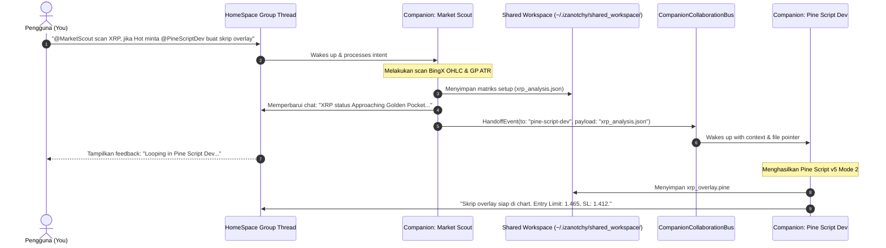

# 05. Multi-Companion Collaboration Specification: Group Chats, Mentions & Handoffs

<!-- Status: Technical Architecture & Collaboration Protocol -->
<!-- Reference: docs.x.ai/grok-bot/chat-and-collaboration -->
<!-- Date: September 2026 -->

---

## 🎯 1. Paradigma Kolaborasi Grok Bot: "Connect the Bots"

Dalam dokumentasi Grok Bot:
> *"Put a few Bots in the same thread and they pass work between themselves. You watch them take action instead of approving every step... A Bot can send an asynchronous message to another Bot. The receiving Bot wakes, handles the request, and can reply later."*

Di Izanotchy, saat ini setiap companion hanya hidup di tab terpisah. Jika pengguna ingin hasil riset dari *Research Buddy* dipakai oleh *Market Scout*, pengguna harus melakukan *copy-paste* manual.

Dokumen ini mendefinisikan arsitektur **Multi-Companion Collaboration Mesh** yang memungkinkan:
1. **Group Chat Thread** di HomeSpace Studio (menggabungkan 2–4 companion dalam satu misi).
2. **Sintaks @Mention** untuk mendelegasikan tugas ke spesialis tertentu.
3. **Asynchronous Handoffs**: Bot A menyelesaikan fase 1, menyimpan artefak ke `/shared_workspace/`, dan memanggil Bot B untuk melanjutkan.
4. **Visual Resource Mutex (Anti-Tabrakan Kursor CUA)**: Mengunci resource layar fisik agar tidak ada dua bot yang menggerakkan mouse secara bersamaan.

---

## 🔄 2. Siklus Alur Kerja Handoff Antar-Companion



---

## 🧩 3. Komponen Teknis di Izanotchy

### A. Model Data Group Session
Di `CompanionRosterStore.swift`, kita menambahkan tipe session baru:

```swift
public struct CompanionGroupSession: Identifiable, Codable {
    public let id: UUID
    public var name: String                  // e.g. "Alpha Trading Squad"
    public var memberSlugs: [String]         // ["market-scout", "pine-script-dev", "risk-manager"]
    public var messages: [HomeSpaceChatMessage]
    public var activeSpeakerSlug: String?
    public var createdAt: Date
}
```

### B. Event Bus Kolaborasi: `CompanionCollaborationBus`
Sistem antrian asinkron berbasis Swift Actor untuk menjamin keamanan *thread-safety* dan mencegah perebutan sumber daya:

```swift
public actor CompanionCollaborationBus {
    public static let shared = CompanionCollaborationBus()
    
    public struct HandoffRequest: Sendable {
        public let fromSlug: String
        public let toSlug: String
        public let reason: String
        public let sharedArtifactPath: String?
        public let priority: Int
    }
    
    private var pendingQueue: [HandoffRequest] = []
    private var isVisualCuaBusy: Bool = false
    
    /// Meminta kunci visual (Visual Lock) untuk aksi CUA di layar
    public func acquireVisualLock(for companionSlug: String) async -> Bool {
        if isVisualCuaBusy {
            return false // Tunggu atau antrekan
        }
        isVisualCuaBusy = true
        return true
    }
    
    public func releaseVisualLock(for companionSlug: String) {
        isVisualCuaBusy = false
    }
    
    public func submitHandoff(_ request: HandoffRequest) async {
        pendingQueue.append(request)
        await processNextHandoff()
    }
    
    private func processNextHandoff() async {
        guard !pendingQueue.isEmpty else { return }
        let next = pendingQueue.removeFirst()
        
        // Trigger eksekusi bot penerima di thread HomeSpace
        await MainActor.run {
            NotificationCenter.default.post(
                name: Notification.Name("CompanionHandoffReceived"),
                object: nil,
                userInfo: [
                    "from": next.fromSlug,
                    "to": next.toSlug,
                    "artifact": next.sharedArtifactPath ?? ""
                ]
            )
        }
    }
}
```

---

## 🔒 4. Manajemen Kunci Layar Fisik (Visual Resource Mutex)

Inilah solusi atas keterbatasan fisik macOS (hanya 1 kursor mouse fisik):
1. **Pemisahan Tipe Tugas**:
   - Jika *Market Scout* hanya membaca API BingX, itu adalah operasi Plane A (0 sentuhan layar). Bot lain bebas beroperasi.
   - Jika *Pine Script Dev* harus membuka TradingView dan mengetikkan kode ke Pine Editor, ia meminta `acquireVisualLock`.
2. **Antrian Non-Blocking**:
   - Jika layar sedang dipakai bot lain, bot kedua menunda langkah visualnya dan menampilkan status `Waiting for screen...` di kartu chat.
   - Segera setelah bot pertama selesai dan melepaskan lock, bot kedua otomatis melanjutkan tugasnya.
   - Pengguna selalu melihat transisi yang mulus tanpa bentrokan klik di layar.
