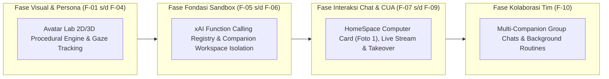

# 06. Implementation Roadmap & Milestones: Rencana Eksekusi Bertahap

<!-- Status: Structured Phased Implementation Plan -->
<!-- Governance: Superpowers + ECC + User Consent Protocol -->
<!-- Date: September 2026 -->

---

## 🛡️ 1. Prinsip Tata Kelola Rekayasa (Mandatory Governance)

Sesuai aturan `AGENTS.md` dan `GEMINI.md`:
1. **User Consent Protocol**: Setiap milestone baru harus disajikan opsinya, diulas resikonya, dan menunggu persetujuan eksplisit pengguna sebelum kode aplikasi dimodifikasi.
2. **Zero Regression Guarantee**: Alur kerja yang sudah ada (analisa koin tunggal `/analisa btc`, radar pasar `/analisa market`, MediaRemoteAdapter pada notch, dan `cua-driver`) dilarang keras rusak.
3. **Verifikasi Fisik Sebelum Klaim Selesai**: Setiap milestone wajib lolos kompilasi bersih (`xcodebuild` exit code 0), lolos test suite TDD otomatis, verifikasi PID baru yang berjalan, dan inspeksi log `clicky.log`.

---

## 🗺️ 2. Hubungan Milestone Makro vs Tracker Fitur Mikro

> [!IMPORTANT]
> **Struktur Hubungan Dua Dokumen Pelaksana**:
> - Dokumen ini (**`06_IMPLEMENTATION_ROADMAP_MILESTONES.md`**) mendefinisikan **Fase Arsitektur Makro (M155–M160)** untuk tata kelola versi, integrasi sistem tingkat tinggi, dan pencatatan riwayat di `CHANGELOG.md`.
> - Dokumen [**`09_FEATURE_BY_FEATURE_TRACKER.md`**](file:///Users/heizaaa/Desktop/cdev/iza-3/docs/grok-bot-companion-adoption/09_FEATURE_BY_FEATURE_TRACKER.md) mendefinisikan **Unit Eksekusi Fitur Mikro (F-01 hingga F-10)** dengan alur wajib:  
>   `Backend ➔ Frontend ➔ Cara Ngetest Pengguna ➔ Lanjut/Revisi`.

---

### 📍 Milestone 155: Standardized Function Calling Registry & Tool Dispatcher
- **Tujuan**: Membangun fondasi pemanggilan fungsi terstandarisasi xAI di Izanotchy, memisahkan eksekusi deterministik cepat (Plane A) dari interaksi layar visual (Plane B).
- **Komponen yang Dibuat/Dimodifikasi**:
  1. `boringNotch/Clicky/Tools/ClickyFunctionTool.swift`: Protokol `ClickyFunctionTool`, `ClickyToolResult`, dan model JSON Schema xAI.
  2. `boringNotch/Clicky/Tools/ClickyFunctionToolRegistry.swift`: Singleton registri tools terdaftar.
  3. `boringNotch/Clicky/Tools/ClickyToolDispatcher.swift`: Dispatcher eksekusi paralel via `withTaskGroup`.
  4. Migrasi modul BingX OHLCV dan kalkulator Golden Pocket menjadi tool terdaftar pertama: `get_crypto_market_analysis`.
- **Kriteria Verifikasi TDD**:
  - Test script `scripts/test_function_calling_registry.swift`.
  - Menguji registrasi tool, validasi JSON Schema parameter, eksekusi paralel, dan penanganan error.

---

### 📍 Milestone 156: Per-Companion Workspace & Storage Isolation
- **Tujuan**: Menghadirkan lingkungan kerja persisten mandiri untuk setiap companion (`~/.izanotchy/companions/<slug>/`).
- **Komponen yang Dibuat/Dimodifikasi**:
  1. `boringNotch/Clicky/Onboarding/CompanionWorkspaceManager.swift`: Ekspansi pembuatan folder `workspace/`, `shared_workspace/`, `browser_data/`, dan `memory.json`.
  2. Tool baru: `workspace_file_operation` (read, write, list) dan `companion_memory_store`.
- **Kriteria Verifikasi TDD**:
  - Test script `scripts/test_companion_workspace_isolation.swift`.
  - Menguji bahwa file yang ditulis oleh satu companion tersimpan di foldernya sendiri dan file yang dibagikan tersedia di `shared_workspace/`.

---

### 📍 Milestone 157: HomeSpace Computer Card (1:1 Foto 1) & Window Frame Snapshot Stream
- **Tujuan**: Mengimplementasikan antarmuka visual kartu chat `[Computer • Working / Done]` yang menampilkan frame jendela aplikasi yang sedang dikerjakan companion, persis seperti foto yang diunggah pengguna.
- **Komponen yang Dibuat/Dimodifikasi**:
  1. `boringNotch/Clicky/ClickyEnums.swift`: Perluasan `HomeSpaceChatMessage` dengan payload polimorfik `computerPayload: ComputerCardPayload?`.
  2. `boringNotch/Clicky/HomeSpace/HomeSpaceComputerCardView.swift`: Komponen SwiftUI baru (Header, status pill, teks instruksi, frame visual jendela dark-mode, dan tombol aksi).
  3. Integrasi ke `HomeSpaceRootView.swift` di dalam alur pesan chat.
  4. Penyambungan `CGWindowListCreateImage` agar saat companion bekerja, ia menghasilkan snapshot PNG berkala ke `workspace/snapshots/` dan mengalir ke kartu chat.
- **Kriteria Verifikasi**:
  - Tangkapan layar targeted window pada HomeSpace yang membuktikan kartu `Computer` ter-render rapi dengan status pill dan gambar frame jendela.

---

### 📍 Milestone 158: Human Takeover Protocol untuk 2FA, Login & CAPTCHA
- **Tujuan**: Memberikan kemampuan kepada companion untuk meminta bantuan pengguna ketika mendeteksi layar login, 2FA, atau password, tanpa meminta kredensial di chat teks.
- **Komponen yang Dibuat/Dimodifikasi**:
  1. Tool baru: `request_human_takeover(service:reason:windowId:)`.
  2. Kartu `HomeSpaceComputerCardView` merespons status `.takeoverNeeded` dengan menampilkan tombol kuning *"Take Over Screen"*.
  3. Logika pelepasan mouse: Izanotchy menghentikan CUA, memunculkan jendela target ke depan, menunggu pengguna menekan *"Resume"*, lalu melanjutkan otomasi secara otomatis.
- **Kriteria Verifikasi TDD**:
  - Simulasi alur takeover: Tool memicu status pending, verifikasi UI menampilkan tombol, sinyal resume memicu status working kembali.

---

### 📍 Milestone 159: Multi-Companion Collaboration Mesh & Group Chats
- **Tujuan**: Menghubungkan para companion dalam satu thread chat bersama, mendukung sintaks `@mention`, dan transfer tugas asinkron (*handoff*).
- **Komponen yang Dibuat/Dimodifikasi**:
  1. `boringNotch/Clicky/Roster/CompanionCollaborationBus.swift`: Actor event-bus untuk mengelola handoff dan `VisualLock` (mutex kursor CUA).
  2. `boringNotch/Clicky/HomeSpace/HomeSpaceRootView.swift`: Autocomplete `@BotName` di composer dan UI group chat.
- **Kriteria Verifikasi TDD**:
  - Test script `scripts/test_companion_collaboration_bus.swift` menguji handoff antar dua companion dan antrian lock visual.

---

### 📍 Milestone 160: Skills, Routines & Background Scheduler
- **Tujuan**: Mengadopsi fitur *Routines* dari Grok Bot agar companion dapat menjalankan tugas berulang terjadwal (misal: analisa pasar tiap 4 jam atau pemantauan pipeline semalam).
- **Komponen yang Dibuat/Dimodifikasi**:
  1. `boringNotch/Clicky/Routines/CompanionRoutineManager.swift`: Pengelola jadwal berbasis cron/timer lokal macOS.
  2. Tab antarmuka *Routines* di detail percakapan companion.
- **Kriteria Verifikasi**:
  - Eksekusi rutinitas uji coba di background yang menulis hasil analisis ke `workspace/deliverables/`.
