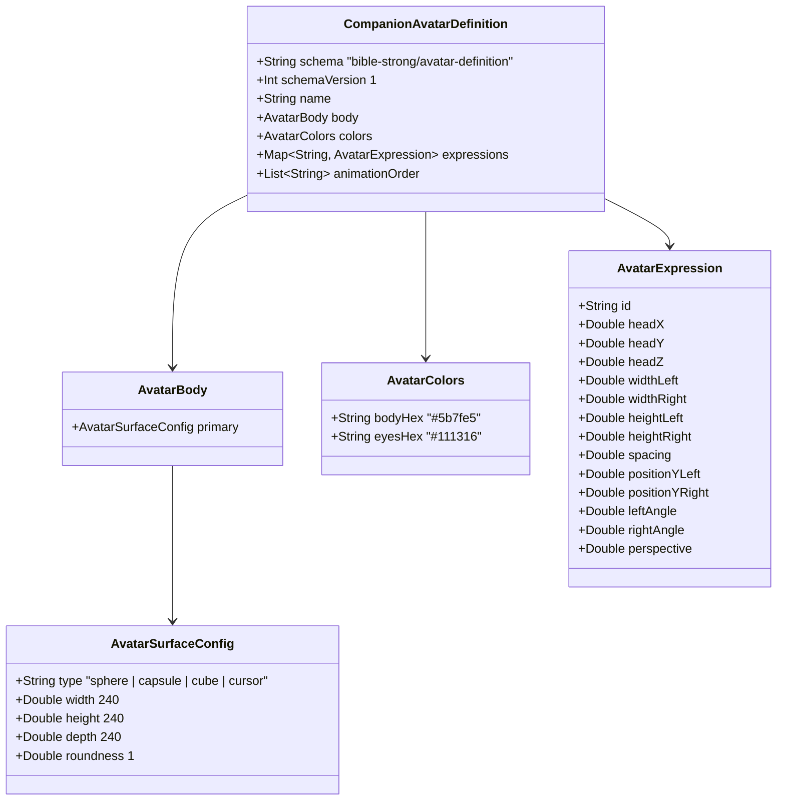

# 07. Avatar Lab Character System: Mengadopsi Strobi 3D Prosedural Engine

<!-- Status: Autentik 1:1 Spesifikasi Bible Strong Avatar Lab -->
<!-- Source Reference: https://github.com/smontlouis/bible-strong-avatar-lab -->
<!-- Target: Menggantikan ikon awan flat (AgentCloudFaceMood) dengan Model Strobi 3D Asli -->
<!-- Date: September 2026 -->

---

## 🎨 1. Latar Belakang & Klarifikasi Desain Autentik

Pengguna menginstruksikan secara spesifik:
> *"Untuk character-nya kita akan membuat character dari sini https://github.com/smontlouis/bible-strong-avatar-lab itu mirip-mirip lah, jadi menggantikan icon-icon awan kita sekarang."*

### ⚠️ Koreksi Mispersepsi Awal (Post-Mortem):
- **Bukan Karakter Kartun/Anime**: Avatar Lab **TIDAK** menggunakan mata putih dengan pupil hitam, pipi blush, atau mulut senyum.
- **Model Asli Strobi**: Berdasarkan repositori resmi `smontlouis/bible-strong-avatar-lab`, karakter dasarnya bernama **Strobi**:
  1. **Tubuh Bola/Kapsul 3D Minimalis**: Siluet kepala berupa sphere/capsule/cube 3D solid yang bersih dan berdimensi.
  2. **Sepasang Mata Kapsul/Pill Gelap (`#111316`)**: Mata berupa kapsul vertikal gelap yang diproyeksikan langsung ke kurvatur bola 3D.
  3. **Rotasi Kepala 3D Penuh (Pitch/Yaw/Roll)**: Orientasi kepala diatur secara matematis oleh sudut Euler (`headX`, `headY`, `headZ`) yang dikonversi ke Quaternion.
  4. **Ekspresi Melalui Vektor 3D**: 100% ekspresi (*curious, skeptical, attentive, joyful, alert*) disampaikan melalui perputaran kepala 3D, jarak mata (*spacing*), sudut kemiringan (*leftAngle*, *rightAngle*), serta peregangan tinggi/lebar kapsul mata.
  5. **Kedipan Squash Alami**: Saat berkedip, tinggi kapsul mata menyusut halus secara vertikal (`height = 5 + (restingHeight - 5) * blink`).

---

## 📐 2. Anatomi Model Data Strobi: `CompanionAvatarDefinition`

Struktur berkas `.avatar.json` dari Bible Strong Avatar Lab diadopsi ke dalam Swift model di Izanotchy:

---

## 🎭 3. Roster Companion Izanotchy Berbasis Model Strobi

Setiap companion Izanotchy mengadopsi model Strobi dengan diferensiasi palet warna kepribadian dan ekspresi default:

| Companion | Slug | Model Dasar | Warna Tubuh (`bodyHex`) | Warna Mata (`eyesHex`) | Karakter Ekspresi Khas |
| :--- | :--- | :--- | :--- | :--- | :--- |
| **Clicky (Strobi)** | `clicky` | Sphere 3D | `#5b7fe5` (Cornflower Blue) | `#111316` (Deep Charcoal) | *Playful & Curious*: Mata lincah melirik kursor pengguna (`curious-left`, `upward-side-glance`). |
| **Market Scout** | `market-scout` | Sphere 3D | `#8B5CF6` (Electric Purple) | `#0D0E12` (Midnight) | *Analytical & Skeptical*: Mata fokus menganalisa chart kandel (`skeptical-right`, `attentive-left`). |
| **Research Buddy** | `research-buddy` | Sphere 3D | `#10B981` (Emerald Green) | `#0F172A` (Slate Dark) | *Attentive & Thoughtful*: Mata menatap fokus saat crawling data (`upward-side-glance`, `neutral`). |
| **Shippy** | `shippy` | Sphere 3D | `#F97316` (Warm Orange) | `#18181B` (Zinc Dark) | *Action-Oriented*: Ekspresi bangga dan gembira saat aksi task selesai (`joyful-down-right`, `neutral`). |

---

## 🔬 4. Matematika Proyeksi Permukaan 3D (`Strobi3DMath`)

Setiap titik kapsul mata dihitung melalui pipeline proyeksi:

1. **Polygon Kapsul Lokal**: `roundedRectangle(width, height)` menghasilkan titik-titik kontur kapsul mata.
2. **Rotasi Bidang**: `rotatedX = lx * cos(angle) - ly * sin(angle)`.
3. **Koordinat Bola Kanonikal**:
   $$\text{longitude} = \frac{x}{R}, \quad \text{latitude} = \frac{y}{R} \quad (R = 120)$$
   $$\text{faceX} = R \cdot \cos(\text{latitude}) \cdot \sin(\text{longitude}), \quad \text{faceY} = R \cdot \sin(\text{latitude})$$
4. **Depth & Normal Bola (Ellipsoid Front Sample)**:
   $$z = r_z \sqrt{\max\left(0, 1 - \frac{x^2}{r_x^2} - \frac{y^2}{r_y^2}\right)}$$
5. **Rotasi Quaternion Kepala**:
   $$P_{\text{rot}} = q \cdot P \cdot q^{-1}$$
6. **Proyeksi Perspektif**:
   $$\text{scale} = \frac{F}{F - P_{\text{rot}}.z \cdot \text{perspective}} \quad (F = 620)$$
   $$x_{\text{screen}} = P_{\text{rot}}.x \cdot \text{scale}, \quad y_{\text{screen}} = P_{\text{rot}}.y \cdot \text{scale}$$
7. **Clipping Siluet**: Seluruh mata di-clip ke siluet kepala menggunakan `context.clip(to: headPath)`.

---

## 🚀 5. Roadmap Adopsi Bertahap Karakter Strobi

- [x] **F-01**: Parser Model `.avatar.json` & Render Bola 3D + Kapsul Mata Prosedural (*Selesai & Terverifikasi*).
- [ ] **F-02**: Kedipan Prosedural Otomatis (*squash height* tiap 3.5–6 detik) & Interpolasi Transisi Ekspresi.
- [ ] **F-03**: Dynamic Gaze Tracking (*headX* dan *headY* bergerak dinamis mengikuti posisi kursor mouse).
- [ ] **F-04**: Penggantian Menyeluruh Ikon Awan: Mengintegrasikan Strobi ke Rail Bar, Popover Card, dan HomeSpace.
