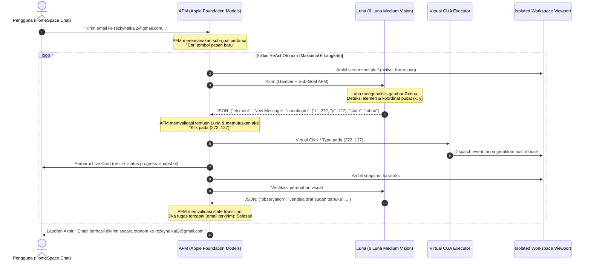

# Implementation Plan: AFM ⇄ Luna Autonomous CUA ReAct Loop

**Tanggal:** 2026-10-03  
**Status:** DRAFT (Menunggu Acc Pengguna)  
**Dokumen Referensi:** [AGENTS.md](file:///Users/heizaaa/Desktop/cdev/iza-3/AGENTS.md), [ERRORS.md](file:///Users/heizaaa/Desktop/cdev/iza-3/ERRORS.md)

---

## 🎯 1. Ringkasan Eksekutif
Mengganti seluruh skrip prosedural hardcoded email di `CompanionVMAgentLoop.swift` dengan **Autonomous CUA ReAct Loop** kolaboratif antara dua model:
1. **AFM (Apple Foundation Models)**: Berjalan 100% on-device di chip Apple Silicon (`http://127.0.0.1:1976`) sebagai **Controller, Task Planner, & State Validator tunggal**.
2. **Luna (6 Luna Medium / gpt-6-luna)**: Berjalan via headless Codex CLI sebagai **Sensor Penglihatan (Visual Perception & Grounder)** resolusi tinggi.

---

## 🏗️ 2. Arsitektur Komunikasi AFM ⇄ Luna

---

## 📋 3. Rencana Implementasi Bertahap

### Tahap 1: Interface Komunikasi Model (`AFMLunaCoordinationBridge.swift`)
- Membuat helper terisolasi untuk interaksi dua model:
  1. `requestAFMPlan(goal: String, history: [StepRecord], latestObservation: String)`:
     - Mengirim system prompt ke AFM di port 1976.
     - Mengembalikan sub-goal dan instruksi pencarian berikutnya dalam format JSON.
  2. `requestLunaPerception(snapshotPath: String, subGoal: String)`:
     - Mengirim screenshot aktif ke 6 Luna Medium (`ChatGPTCodexVisionService`).
     - Mengembalikan nama elemen, koordinat `(x, y)`, dan deskripsi visual.
  3. `requestAFMValidation(goal: String, beforeSnap: String, afterSnap: String, actionDone: String)`:
     - AFM membandingkan perubahan visual dan menyatakan apakah langkah/tugas telah valid selesai.

### Tahap 2: Rombak `CompanionVMAgentLoop.swift` Menjadi Loop ReAct Murni
- Menghapus skrip statis `lowerPrompt.contains("kirim")` dan AppleScript draf bawaan.
- Menggantinya dengan `runAutonomousReActLoop(prompt:slug:appName:onProgress:)`:
  - Menjalankan loop dinamis (maksimal 6-8 iterasi untuk efisiensi).
  - Setiap iterasi:
    1. Ambil snapshot jendela target.
    2. AFM menentukan sub-target berikutnya.
    3. Luna mencari koordinat sub-target pada gambar.
    4. CUA mengeksekusi klik atau ketik virtual.
    5. AFM memeriksa apakah goal utama pengguna telah tercapai.
- Penanganan Human Takeover: Jika Luna mendeteksi CAPTCHA/2FA dialog, AFM menghentikan loop dan meminta `[ ✋ Take Over Screen ]`.

### Tahap 3: Pembaruan UI Sidebar & Composer ke Apple-Powered Native
- Mengganti tampilan akun Gemini/Google AI Pro (`rezkyhaikal11@gmail.com [Pro] 43%`) di Sub-Section 1C [HomeSpaceRootView.swift](file:///Users/heizaaa/Desktop/cdev/iza-3/boringNotch/Clicky/HomeSpace/HomeSpaceRootView.swift#L710-L806) secara permanen dengan desain **Apple Intelligence / Siri AI (AFM)**:
  - Lingkaran Titanium Logo Apple (`apple.logo`) dengan stroke gradasi halus.
  - Label teks "Apple Intelligence" / "Siri AI".
  - Bar kapsul titanium status "Neural Engine" (menggantikan bar persentase kuota Gemini).
- Mengarahkan default model asisten ke `Apple Intelligence (AFM)` pada chip Apple Silicon lokal.

### Tahap 4: Uji Coba & Verifikasi Empiris
1. Pengujian skenario kirim email nyata ke `rezkyhaikal2@gmail.com` via Mail.app di isolated display.
2. Pengujian skenario non-email (Safari browsing / membaca draf) untuk membuktikan sistem 100% tanpa hardcode.
3. Verifikasi log: Konfirmasi pertukaran pesan AFM ⇄ Luna terekam bersih di `clicky.log`.
4. Update `CHANGELOG.md` dan `ERRORS.md`.

